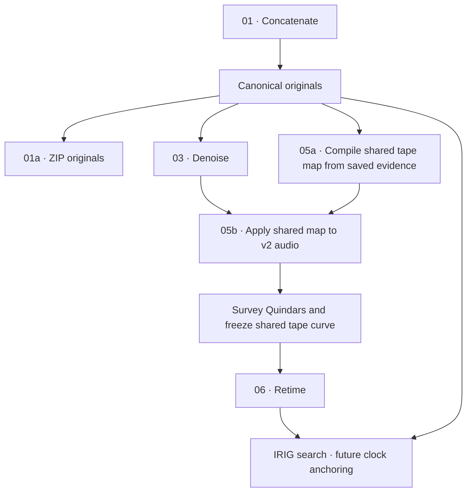

# Apollo 15 audio processing

Processing tools for the Apollo 15 30-track recordings. Current work includes the denoise v2 rollout, flutter correction, and tape-speed retiming. Concatenation, original-file archiving, and the earlier denoise v1 pass are complete.

**Flutter correction is tape-level:** use evidence from all simultaneous tracks
to select one shared timing map, applied across channels at the same tape time.
Missing check tones on an output channel do not independently disable correction.
See [the governing rule and saved-data workflow](docs/tape_level_deflutter.md).
Stage 05 compiles one shared tape map and applies it to completed v2 denoised audio.
Stage 07 adds [speech-level normalization](docs/speech_normalization.md) after
deflutter or retiming, with constant gain to a speech target and a bypass for uncertain channels.
New denoise runs write unity-gain float WAVs; stage 07 sets the final speech level.
Completed denoise outputs retain their existing gain.

Start with the [project status and local artifact guide](docs/project_status.md)
for the November 3 repository audit, research outcome, retained listening
examples, and cleanup/restore locations.

For the current denoise rollout, use the [Windows/Genus production console guide](docs/denoise_cluster.md).
The [v2.16 rollout history](docs/denoise_v2_all_tapes_runbook.md) and
[findings and local evidence index](docs/denoise_v2_plan.md) retain review and migration context.

The active [shared tape workflow](docs/shared_deflutter.md) reuses completed
all-channel surveys, tracking curves, and assessments. Stage 05a selects one
curve per tape-time interval and saves one integrated map. Stage 05b applies
that artifact to completed v2 denoised channels. Historical evidence stays
immutable; per-target planners are no longer active processing entry points.

The [October 30 research findings](docs/deflutter_research_findings.md) qualify
these numerical results: no experimental correction is approved for production.
Stationary electrical interference can pass the response-based checks. The
research code and regression tests are retained under `research/` and `tests/`;
generated reports and listening-site exports remain local.

| Stage | Entry point in `scripts/` | Purpose | Status |
| --- | --- | --- | --- |
| 01 | `01_ingest/01_concatenate.py` | Verify fragment order and assemble canonical channels | Done |
| 01a | `01_ingest/01a_zip_originals.py` | ZIP each canonical tape folder, skipping existing ZIPs | Done |
| 03 v1 | `03_denoise/03_denoise.py` | Remove tones/hum and reduce broadband noise by at most 3 dB | Existing archive |
| 03 v2 | `03_denoise/denoise_v2_console.py` | Qualified accelerated denoising on Windows and Genus | Active rollout; automatic Windows day/night limits |
| 05a | `05_deflutter/05a_plan_deflutter.py` | Compile one map from saved tone evidence across all channels | Shared tape maps |
| 05b | `05_deflutter/05b_deflutter.py` | Apply the tape map to completed v2 channels at their existing gain | Shared tape maps |
| 06 | `06_retime/06_retime.py` | Apply one shared Quindar speed curve per completed tape | Active |
| 07 | `07_normalize/07_normalize.py` | Constant gain to a speech target, noise-only bypass and transient peak limiting | New; listening calibration pending |
| 08 utility | `run.py irig_search.py` | Find provisional IRIG clock snapshots on original CH01-CH04 | Standalone utility in `08_irig/`; integration undecided |



V5 discovers reference candidates in originals and denoised audio, then tracks
and validates their motion in originals because cleanup can remove useful tones.
The 60 Hz harmonic comb is digitization contamination, according to the source
provenance supplied by the project owner; it is excluded as timing evidence.
Flutter maps apply to completed denoised channels. Quindars measure slow
tape-speed drift. IRIG clock discovery remains independent, preserving original
sample coordinates for future anchoring.

## Setup and commands

Python 3.10+ and `uv` are required. Run from the repository root:

```powershell
uv sync --locked
uv run python scripts/pipeline.py plan --stages 05a --tape A15_T510076 --all-channels --plain
uv run python scripts/05_deflutter/05a_plan_deflutter.py --help
uv run python scripts/05_deflutter/inspect_tone.py --help
```

Stage 05a compiles existing evidence without running new discovery or fitting.
Use `--flutter-plan-workers 1` to limit simultaneous map builds while denoising
continues. `plan` previews commands without writes. Stage 05b requires a completed
shared map and completed v2 input. A single tape/channel defaults to stage 05b.
Readiness to render does not imply listening acceptance.

See [the shared-map guide](docs/shared_deflutter.md) for commands to compile,
render, export matched Audition WAVs, and trace visual tone sightings. Stage 05b
supports every numbered channel, including CH01; downstream Quindar analysis
retains its existing audio-channel scope. All outputs preserve source offsets.

## IRIG search

Search the full originals on CH01–CH04 regardless of labels:

```powershell
uv run --extra irig python scripts/run.py irig_search.py --input D:/Apollo_15_30-Track/orig_concatenated --all-tapes --legacy-repo F:/_repos/Apollo_Audio_Processing
```

The external checkout supplies the decoder. Use `--screen-only` without it for carrier screening; `--max-windows 30` bounds a trial. Resume by rerunning without the budget. Reports distinguish incomplete searches, carrier candidates, and qualifying sequential decodes. Clock basis remains provisional until authenticated. This search does not yet anchor the final audio to mission time.

## Data and source layout

Defaults are beneath `D:/Apollo_15_30-Track`; overrides are available in `--help`.

| Folder | Contents | Pipeline override |
| --- | --- | --- |
| `orig_delivery/` | Delivered fragments | `--delivery` |
| `orig_concatenated/` | Canonical originals | `--concatenated` |
| `denoised/` | Completed stage-03 channels | `--denoised-root` |
| `deflutter_planning_v5_allchannel/` | Preserved all-channel tone evidence | `--flutter-evidence-root` |
| `deflutter_planning_shared/` | One map and selection provenance per tape | `--flutter-planning-root` |
| `defluttered_shared/` | Stage-05b audio from v2 channels | `--defluttered-root` |
| `quindar_post_deflutter_analysis_v5/` | Surveys and frozen tape curves | `--quindar-analysis-root` |
| `defluttered_retimed_v5/` | Stage-06 audio | `--retimed-root` |
| `speech_normalized/` | Stage-07 listening WAVs and measurement reports | `--normalized-root` |
| `irig_search/` | Independent IRIG screening and clock evidence | Standalone search `--output` |

- `scripts/`: the top-level `pipeline.py`, the `run.py` dispatcher, and numbered stage folders described in [the script layout guide](docs/script_layout.md).
- `tests/`: processing, checkpoint integrity, acceptance, and pipeline integration checks. Synthetic demo generation lives here.
- `docs/`: the current operating guide and explanatory measurement images.
- Local `reports/`, `runs/`, and `archive/` are ignored artifacts. Recordings and processing outputs are not distributed with the source.

One-off experiments, old cleanup previews, the regional planner, and excerpt-manifest rendering have been retired. Historical saved-map reading remains for evidence compatibility. Source changes invalidate implementation-bound flutter plans and acceptance; use fresh destinations rather than changing old records. Completed stage-03 intermediates retain their existing cleanup fingerprint.

## Measurement examples


T510073 CH06, a 30-second review excerpt: grey is original, orange is after tone/hum cleanup, green adds the current 3 dB-capped broadband step. The lower plot isolates the broadband change. This illustrates cleanup, not proof of speech preservation.


Historical T510083 CH20 assessment: measured Quindars, a smoothed speed curve, and accumulated timing change. This single-channel example explains the method; production freezes a shared curve only after surveying the completed tape. Sparse coverage and unknown generator accuracy limit absolute calibration.

## Validation

```powershell
uv run python -m unittest discover -s tests -v
uv run --with pytest python -m pytest tests -q
```
