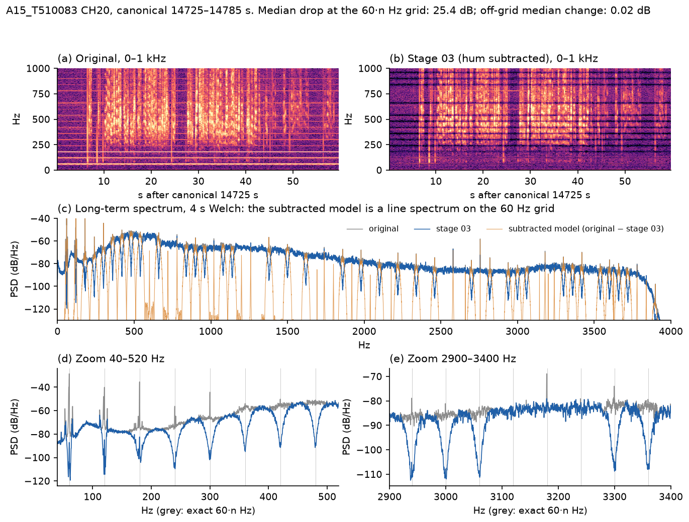
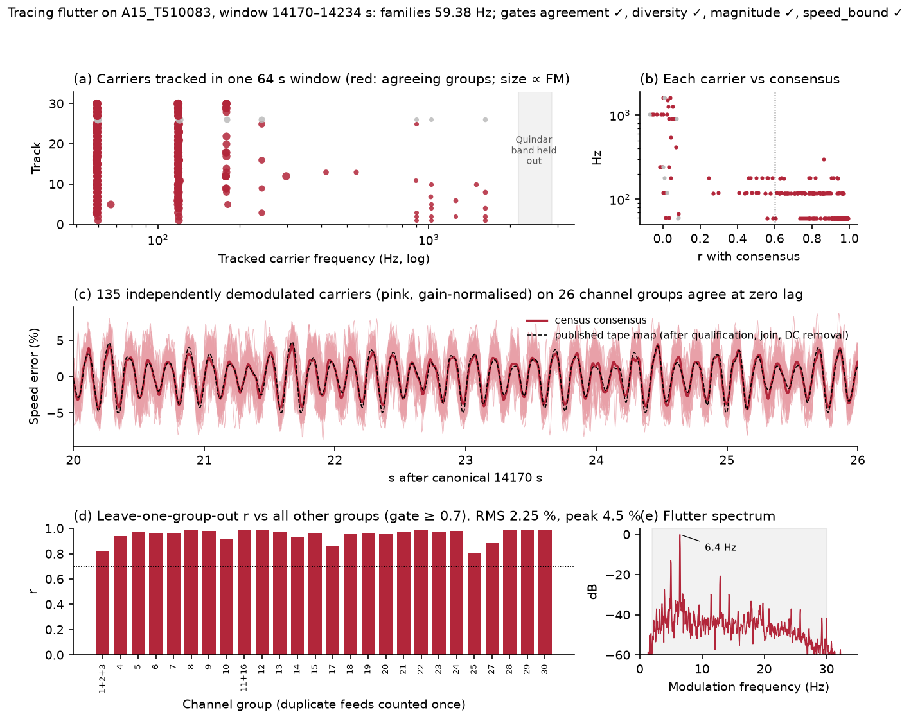
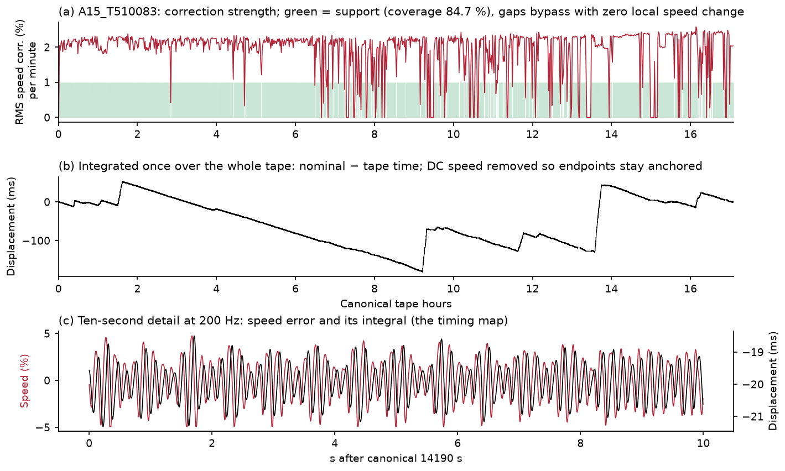
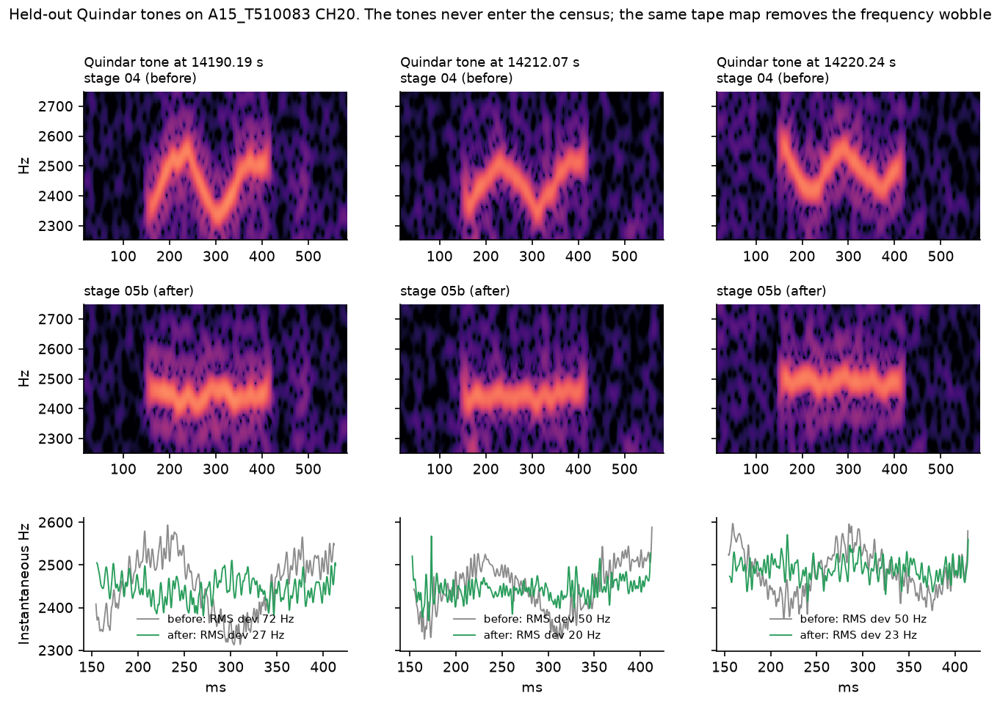
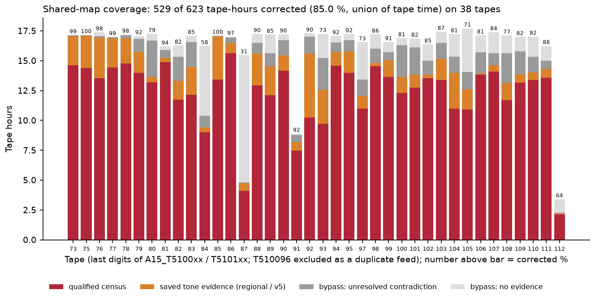
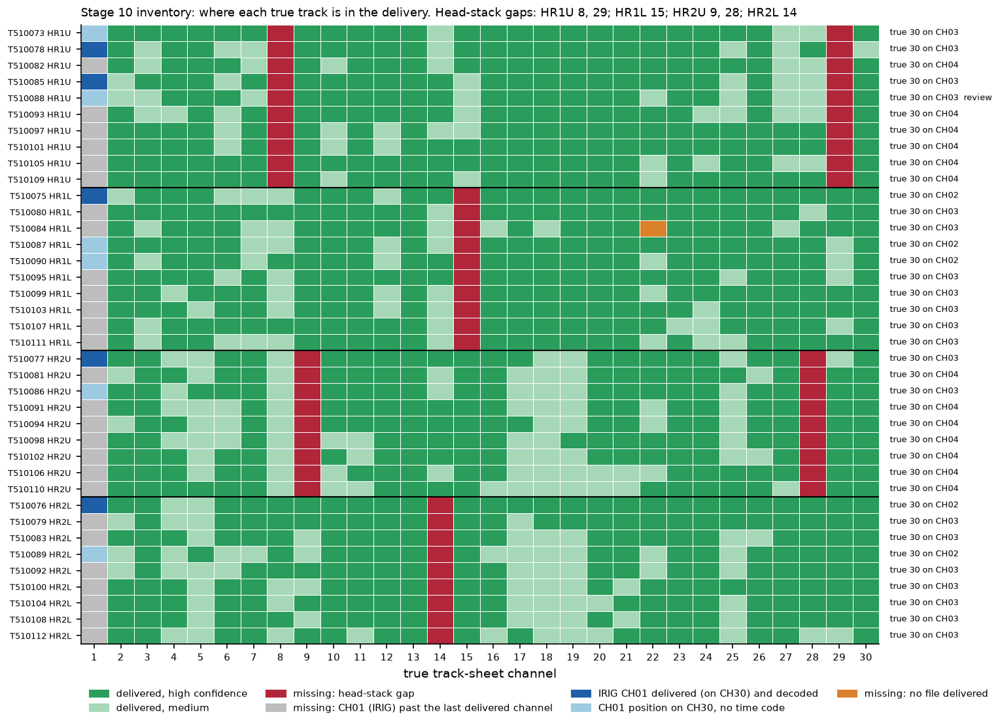
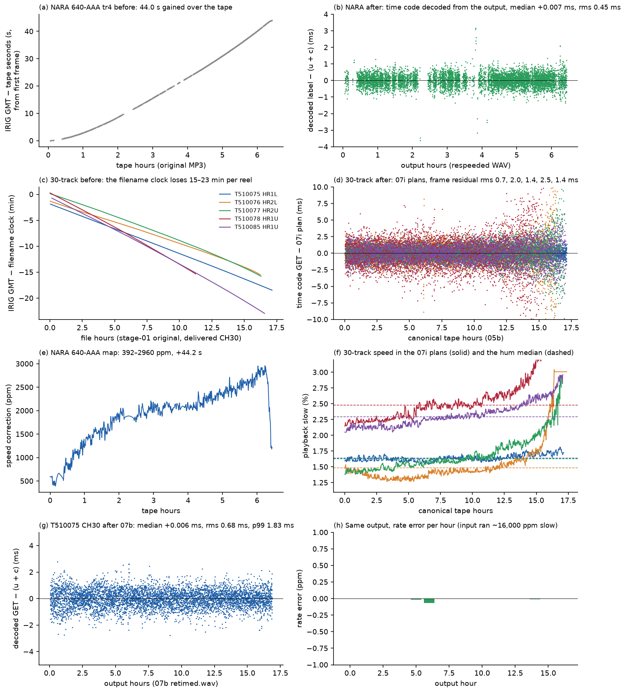
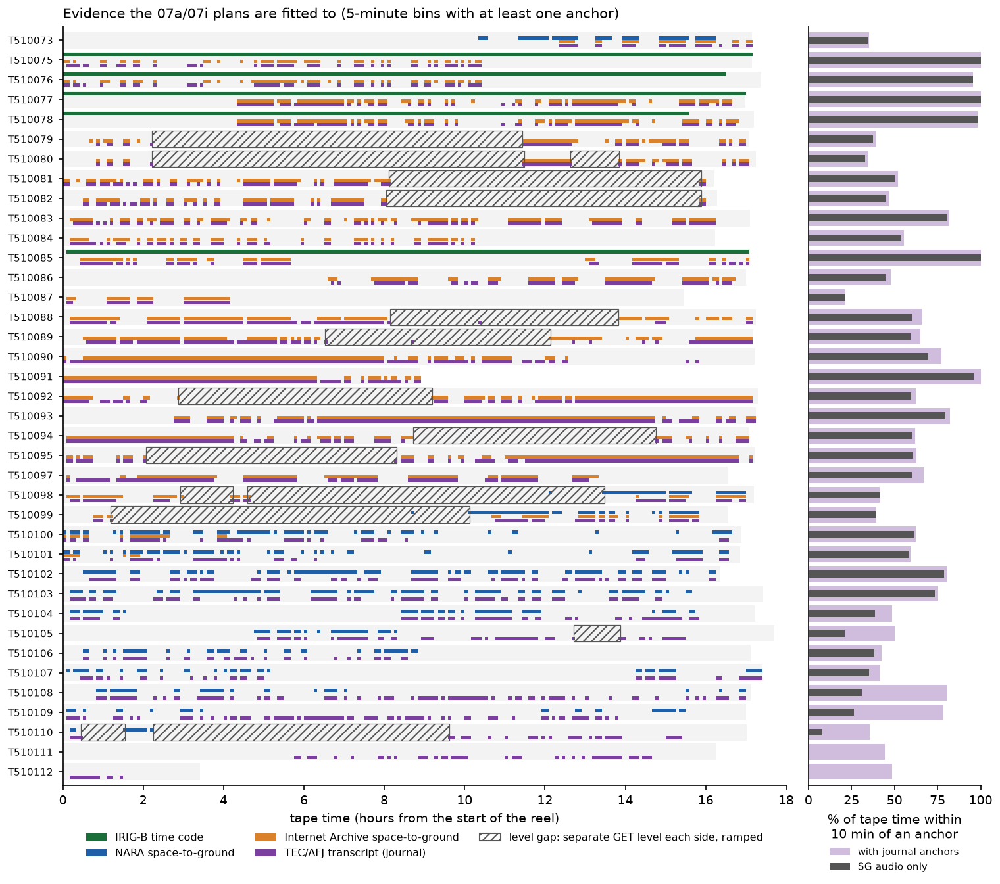
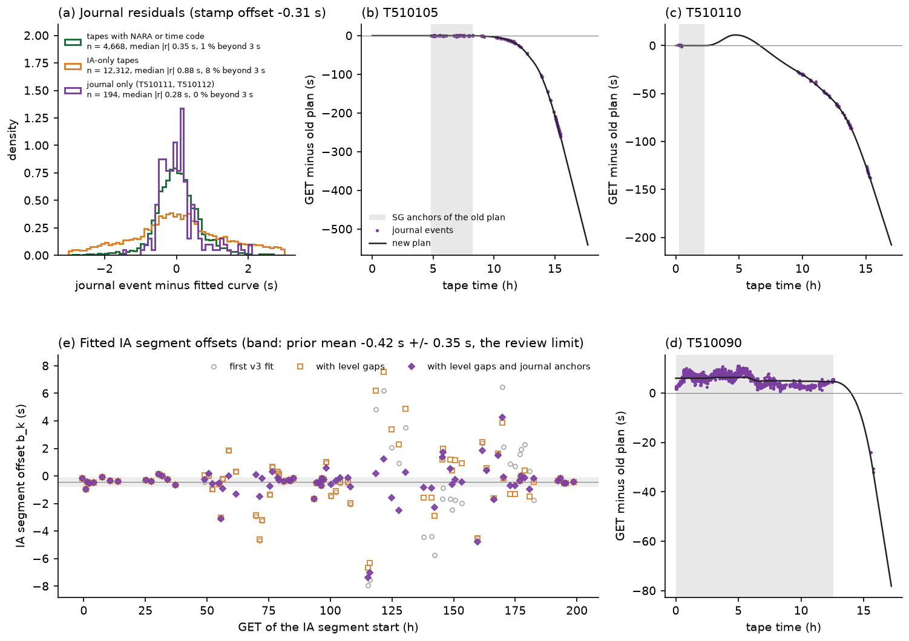

# Restoring the Apollo 15 Mission Control 30-track recordings: hum subtraction, crosstalk removal and shared-tape flutter correction

**Status, 27 November 2026.** Stages 01–05 have been run across the archive. Stage 06
(the timing transcript of the stage-05b audio) is complete. Stage 10 has identified the true
track-sheet channel of every delivered file and inventoried the tracks that were never
digitized (§9). That work found IRIG-B time code on five reels. Stage 07i has built
retiming plans for those five reels from it, checked end to end to 0.68 ms rms (§10.3).
Stage 07a has fitted every other reel to mission time: against the retimed space-to-ground
reels, and directly against the 1971 transcripts where those reels do not reach (§10.4, §10.6).
All 38 reels with signal now have a plan. Stage 07b is applying them to the archive on two
machines (§10.7). Stage 08 then writes the 8 kHz 16-bit delivery files. The one-page
[pipeline overview](docs/00_pipeline_overview.md) lists every stage, its data and its format. All numbers below come from
the published archive records under `D:/Apollo_15_30-Track`, and all figures are
regenerated from those records by `research/readme_figures/` (Appendix A).

---

## Executive summary

Apollo 15 Mission Control recorded its voice loops on **two side-by-side 30-track
recorders, HR1 and HR2**: 60 simultaneous tracks of flight-controller loops,
air-to-ground and network audio for the whole mission. Each recorder alternated
between an upper and a lower head stack, changing reels about every 17 hours with a
roughly 30-minute overlap. The mission ran 295 hours from launch (26 July 1971,
13:34 UTC) to splashdown (7 August, 20:46 UTC) and filled **40 reels**, about
**19,700 track-hours** of audio.


**Figure 1.** The 40 reels on the mission timeline (filename clock, 1971 day of year).
Hatched blue reels have mis-dated boxes. They are placed by their handover sequence, which
stage 07a confirms to about a minute (E.6).
*Right:* playback speed of each digitized reel, from about 40 peak measurements per
reel of the 1971 hum at 60·ρ·n Hz after exact-line removal.

| Measure                                         | HR1            | HR2            | Total                  |
| ----------------------------------------------- | -------------: | -------------: | ---------------------: |
| Reels recorded                                  | 20             | 20             | 40                     |
| Reels delivered with program audio              | 20             | 18             | 38                     |
| Usable track-hours                              | 10,139         | 8,536          | 18,675 (94.8 %)        |
| Track-hours missing                             | 0              | 1,014          | 1,014 (5.2 %)          |
| Mission time covered, launch to splashdown      | 100 %¹         | 93.0 %         | 60 tracks: 93.0 %      |

¹ Includes T510087 and T510111, whose boxes carry impossible dates (§E.6). Their
placement is inferred and remains provisional. Without them, HR1 covers 93.9 %.

The digitized tapes posed a series of problems. Each one either required a new
technique or determined how the processing had to be ordered.

**E.1 Channel numbers reversed; time code mostly missing.** Track 1 should carry the IRIG
time code. The digitization team set up the tape alignment incorrectly, and the delivered
channel identifiers are wrong. Stage 10 (§9) shows that the delivered numbers count from the
*opposite* tape edge: delivered CH02, CH03 or CH04 (depending on the reel) reads true CH30, and
each higher delivered number reads the next lower true track. Each head stack also skips one or
two true tracks. True CH01 (IRIG) therefore falls on delivered CH30 or beyond it. It was
digitized on 11 of the 38 reels with signal, and it decodes as IRIG-B on 5 of them. Stage 07i
retimes those five from it (§10.3). The
maps are not yet applied to file names, so every channel number in this document refers
to the *delivered file numbering* unless it is called "true".

**E.2 A new way to de-flutter.** The tapes flutter: their speed wobbles about 2 % RMS
at 2–30 Hz (6.4 Hz dominates in the window of Figure 7), which warbles every voice
and tone.
Correcting flutter requires a steady carrier recorded on the same tape, and IRIG would
have been the obvious one. Without it, and with Quindar tones too sparse and present only
on some tracks, we developed a **blind, check-tone-free method** (§6). It finds every
faint carrier on every track, demodulates each one independently, and keeps only the
motion that independent tracks of one tape agree on at zero lag. Because all 30 tracks
share one moving tape, the agreed motion becomes **one timing map per tape**, applied
identically to all 30 tracks. On about 34,800 Quindar tones the method never saw, it cuts
the median frequency wobble from 52 Hz to 13 Hz. It corrects 85 % of the 623 tape-hours
and leaves the rest untouched rather than guessing.

**E.3 Digitization hum far louder than the signal.** The playback machine was not
grounded during digitization. It injected 60 Hz mains hum and a full comb of harmonics
up to 3.9 kHz, and this hum is often much stronger than the program. On sampled minutes,
the hum carries a median **8×** the power of everything else on the track, and over
**50×** in a quarter of them. At 180 Hz the digitization line is a median **700×**
(28.5 dB) stronger than the faint 1971 hum line that flutter tracking relies on. Our
answer is **model-based hum subtraction** (§4), rather than notch filtering or
broadband denoising. A phase-locked model of each line is fitted on quiet audio,
accepted only if it validates on separate held-out audio, gated off where the line
vanishes, and subtracted. Speech and hiss away from the 60 Hz grid are left intact
(Figure 4).

**E.4 Slow, miscalibrated tape machines, and a lucky consequence.** The playback machine was not
restored to proper working order and runs slow. The hum recorded in 1971 should replay
at 60 Hz, but it appears at 58.5–59.3 Hz, so the digitized tapes play **1.2–2.5 %
slow**. The per-head medians are 2.4 % (HR1U), 1.75 % (HR1L), 1.74 % (HR2U) and
1.37 % (HR2L) (Figure 1, right). A 17-hour reel therefore plays roughly 12–25 minutes
long. These figures assume the 1971 mains ran at its nominal 60 Hz. The IRIG-B found on five
reels (§10.3) confirms the hum medians to within 0.12 %, and to within 0.05 % on four of
them. This is a timing error that stage 07 must correct against mission time.

*Each 1971 transport ran at its own speed.* The speed error is not one common number.
Each head group carries its own error, steady over the 9–10 reels it recorded across
the 13-day mission:

| Group | Reels | Median slow | Range         | Reel-to-reel SD |
| ----- | ----: | ----------: | ------------: | --------------: |
| HR1U  |    10 |      2.36 % | 2.17–2.45 %   |          0.09 % |
| HR1L  |    10 |      1.75 % | 1.59–1.92 %   |          0.10 % |
| HR2U  |     9 |      1.74 % | 1.52–1.82 %   |          0.10 % |
| HR2L  |     9 |      1.37 % | 1.22–1.46 %   |          0.07 % |

The upper and lower decks of the same recorder differ by 0.6 (HR1) and 0.4 (HR2)
percentage points, four to six times the reel-to-reel scatter. The measured hum
frequency is the ratio of playback speed to record speed. A fault in the digitization
playback alone would shift every reel by the same amount. An offset that follows the
1971 deck, reel after reel, points to the original transports: **each was slightly
miscalibrated, by its own amount**. The playback machine's slowness is a shared factor
on top of that. Until the digitization logs are checked, it remains possible that each
group was digitized on a separate playback setup.

With IRIG on track 1 (E.1), this would have been routine to find and correct. The
time code encodes true seconds, so its replay rate on each reel would give that reel's
absolute speed directly, and would separate record-speed from playback-speed error.
Without it, the 1971 hum is the only speed reference on the tapes. Stage 07 will
calibrate the speed against mission time, and the per-deck structure helps there. A
few constants, one per transport, should explain every reel in its group. A reel that
breaks from its group's speed is an immediate flag for a mislabelled head, a mis-dated
box (E.6) or a change of machine.

*The lucky coincidence.* The tapes carry two mains hums:

- **The 1971 hum.** It was picked up when the loops were recorded, so it sits *on the
  tape* and moves with the tape. Every wobble of the transport frequency-modulates it,
  which makes it a flutter witness present on almost every track. This is the signal
  E.2 needs.
- **The digitization hum.** It came from the ungrounded playback machine in the
  present day and was added *after* the tape heads, at exactly 60·n Hz. It is perfectly
  steady, ignores tape motion, carries no flutter information, and is much louder: a
  median 11 dB above the 1971 line at 60 Hz and 28 dB (about 700×) at 180 Hz (E.3).

Had the tapes been replayed at the correct speed, both hums would sit on exactly the
same frequencies. The weak 1971 line would then be buried under the strong modern
one. Removing the modern line would also remove the steady part of the 1971 line
underneath it, and what remained of the 1971 hum could not be separated from the
residue of that subtraction. The flutter witness would have been lost.

The miscalibration moves them apart. Because the tapes replay 1.2–2.5 % slow, the
1971 hum comes out at 58.5–59.3 Hz instead of 60 Hz. That is 0.7–1.5 Hz below the
digitization line at the fundamental, 2–4.5 Hz below it at 180 Hz, and further at
higher harmonics. The census removes the modern lines with a fit only about 1/16 Hz
wide: their frequency is measured to a fraction of a 0.06 Hz bin and fitted over 16 s
blocks. It can therefore delete the 60·n Hz lines almost completely while leaving the
1971 lines, at least 11 bins away and more at higher harmonics, untouched (Figure 6). In short, the defect
that corrupts the timing (E.4) also keeps the one signal that lets us repair the
flutter (E.2) clear of the defect that corrupts the sound (E.3).

**E.5 Tracks captured with time offsets.** The crosstalk work revealed that some
tracks were offset in time from the rest of their tape. The digitizers had started
recording some channels before others, or the recording software had introduced an
equivalent offset. 55 tracks on 7 tapes are offset by 0.98–11.87 s. Stage 02 now
measures these offsets from cross-track matches at independent points along each reel,
and every later stage uses them (§3, Figure 3).

**E.6 Missing, empty and mislabelled reels.**

- **T510074** (HR2U, launch day 01:30–18:05 UTC) was photographed but never
  delivered as audio.
- **T510096** (HR2U, 3–4 August) is a forgery with no signal. All 30 delivered files
  are byte-identical and contain no program audio, so the reel is effectively missing
  from the archive.
- Together, these two leave **20.6 mission hours** with no HR2 audio, including
  4.5 hours after launch: **1,014 track-hours**, 5.2 % of the recorded audio.
- **T510087** and **T510111** carry box dates of 7 July and 7 May 1971, and box
  durations that contradict the digitized length. Their start times fit the HR1
  handover sequence exactly (a 14:53 start just before T510085 ends; 06:25 just before
  T510109 ends). We placed them on 30 July and 7 August. Stage 07a confirms both: the
  space-to-ground and transcript matches put T510087 72–76 s and T510111 22–34 s from that
  inferred placement (§10.6).

**Where things stand.** Stages 01–05 are complete. All 1,169 delivered tracks have
been hum-subtracted and crosstalk-processed, and the 1,139 tracks of the 38 reels with
signal have been de-fluttered with their tape's shared map. Stage 06 has transcribed that
audio, and the transcripts have resolved the channel numbering (E.1): stage 10 maps every
delivered file to its true track (§9). They also put each reel on mission time. Five reels
are timed from their own IRIG-B (§10.3). The other 33 are matched against the respeeded
space-to-ground reels and against the 1971 transcripts themselves (§10.4–10.6). Stage 07b is
now removing the slow-playback error (E.4) from every track, one map per tape (§10.7).

---

## Abstract

The Apollo 15 Mission Control recordings consist of 40 analogue reels from two
30-track recorders, each reel carrying 30 simultaneous tracks of voice loops and
air-to-ground audio. 39 reels were digitized as 8 kHz mono WAVs, 1,169 numbered tracks
in all. Three defects limit their usefulness:
(i) mains hum, introduced both in 1971 and during digitization, (ii) a delayed
copy of speech leaking into neighbouring tracks, and (iii) tape flutter, a 2–30 Hz
speed modulation of about 2 % RMS that audibly warbles every tone and voice. We describe
a provenance-bound pipeline that subtracts hum with validated line models and removes
evidenced repeats with a two-path adaptive model. It then measures the flutter
*blindly*, with no check tones as input, as the motion that independent tracks of one
tape agree on, using the 1971 mains hum recorded on the tape as the main witness.
One timing map per tape is qualified, compiled and applied identically to all of its
tracks. Over 623 tape-hours on 38 tapes, the map corrects 85.0 % of tape time and
bypasses the rest. On about 34,800 held-out Quindar-tone events never seen by the
detector, median tone frequency deviation falls from 51.9 Hz to 12.6 Hz: a median ratio
of 0.25, with 2.5 % of events worse. The sign-reversed map makes the same events worse
(ratio 1.93), as does the map shifted by 1.5 s (1.12). Results on the 16 tapes withheld
from development match those on the 22 development tapes.

---

## 1. Source material and coordinate system

Each tape (`A15_T5100xx`/`T5101xx`) holds up to 30 tracks recorded **simultaneously on
one moving tape**. This physical fact governs the method. Hum, flutter and dropouts
are properties of the tape transport, so one tape-motion correction exists at each
instant and applies to every track. A track without usable tones still receives the
correction measured on its neighbours.

| Quantity                     | Value                                                                                          |
| ---------------------------- | ---------------------------------------------------------------------------------------------- |
| Tapes delivered              | 39 of 40 (T510073–T510112; T510074 not delivered)                                              |
| Recorders                    | HR1 and HR2, alternating upper (U) and lower (L) head stacks; the head is in each filename     |
| Numbered tracks              | 1,169 (T510084 has no CH11)                                                                    |
| Format                       | mono WAV, 8 kHz, one file per track after stage 01                                             |
| Tape duration                | 3.4–17.7 h; 623.0 h on the 38 tapes processed by stage 05                                      |
| Excluded from flutter stages | T510096: 30 byte-identical files without program audio (E.6)                                   |
| Channel numbers              | As delivered. They run opposite to the track sheet (E.1, §9); true CH01 (IRIG) is on CH30 or not digitized |

**Canonical tape time.** Every track is placed on its tape's clock using the time range
in its filename. The time `t` of a sample is the WAV time plus the track's
`start_seconds`. All stages preserve the frame count, sample rate and offset of each
track, and every stage-04/05 record is expressed in canonical tape seconds. This is a
filename timeline, not authenticated mission time (GET). Anchoring to GET is the purpose
of stage 07.

---

## 2. Pipeline overview


**Figure 2.** Processing stages. The audio path (blue) produces the published WAVs.
The flutter evidence (orange) is measured **on the unprocessed originals**, because
denoising deliberately removes the tones that carry it. It meets the audio path only at
stage 05b, where the qualified tape map is applied to the stage-04 audio. The
mission-clock evidence (green) places each tape on GET: the respeeded NARA and Internet
Archive space-to-ground reels and the 1971 transcripts feed the 07a joint fit, and five
reels carry their own IRIG-B (07i). Stage 07b applies one plan per tape. Dashed boxes are
planned.

| Stage | Entry point (`scripts/30-track/`)      | Function                                                                  | Archive state                                                    |
| ----- | -------------------------------------- | ------------------------------------------------------------------------- | ---------------------------------------------------------------- |
| 01    | `01_ingest/01_concatenate.py`          | Verify fragment order and continuity; assemble one WAV per track          | Done; originals ZIP-archived by `01a_zip_originals.py`           |
| 02    | `02_alignment/02_align_capture.py`     | Measure fixed capture offsets between tracks                              | Done; 7 tapes corrected                                          |
| 03    | `03_denoise/denoise_v2_console.py`     | Model-based hum subtraction, `apollo15-hum-subtraction-v2.16`             | Done; 1,169 tracks                                               |
| 04    | `04_crosstalk/04_crosstalk.py`         | Subtract evidenced, weaker ~1.38 s repeats                                | Done; 1,169 tracks, 260 with subtraction                         |
| 05    | `05_deflutter/05_detect_flutter.py`    | Blind cross-track tape-motion census on originals                         | Done; 38 tapes                                                   |
| 05    | `05_deflutter/05_analyze_flutter.py`   | Assessment, follow-up, qualification, held-out validation                 | Done; validation passed                                          |
| 05a   | `05_deflutter/05a_plan_deflutter.py`   | Compile one timing map per tape                                           | Done; 38 maps in `deflutter_maps/`                               |
| 05b   | `05_deflutter/05b_deflutter.py`        | Apply the tape map to every stage-04 track                                | Done; 1,139 tracks in `defluttered_shared/`                      |
| 06    | `06_transcribe/06_transcribe.py`       | Timing transcript of 05b audio (shared engine in `00_common/`)            | Done; words CTC-aligned ([runbook](docs/15_2026-11-22_transcription_runbook.md)) |
| 07a   | `07_retime/07a_sg_retime.py`           | SG anchors (IA, NARA) and journal anchors (TEC/AFJ) pooled into one joint curve per tape on the real-time head row, as shared-layout plans | Done; plans for all 38 tapes (`fit-4c59ce211a77c83c`; [SG retiming](docs/20_2026-11-25_sg_retime_30track.md), [head rows and fit](docs/23_2026-11-26_head_rows_and_real_time.md)) |
| 07i   | `07_retime/07i_irig_retime.py`         | Plans from the IRIG-B time code on delivered CH30 (hybrid with 07a evidence) | Done; v2 plans for 5 tapes ([time-code retime](docs/22_2026-11-26_irig_timecode_retime.md)) |
| 07b   | `07_retime/07b_retime.py`              | Apply the tape plan (07i, else 07a) to every track, moving later-row channels earlier by their measured stagger; write the 06 transcript on the output clock and check the mission transcripts against it | Archive run in progress on Proprius and Genus (§10.7) |
| 08    | `08_normalize/08_normalize.py`         | Constant gain to a speech-level target; 8 kHz 16-bit dithered delivery WAV | Planned ([guide](docs/05_2026-11-13_speech_normalization.md))    |
| 09    | `09_irig/irig_search.py`               | Standalone IRIG time-code search (delivered CH01–CH04)                    | Not integrated; the CH30 decode of stage 10 supersedes it        |
| 10    | `10_channelid/10_channelid.py`         | True track-sheet channel of every delivered channel; missing-track inventory | v2 maps with head-row and carrier evidence in `shared-v2/`; not yet applied ([§9](#9-channel-identification-stage-10), [§10.5](#105-which-head-row-is-real-time)) |

The order is fixed. Hum is subtracted first, because it would otherwise dominate the
crosstalk fit. Crosstalk is subtracted before de-flutter, so that measured
donor/main/repeat delays keep their source coordinates. Retiming and level setting
follow.

Five rules apply throughout:

1. **One tape, one motion.** Evidence may come from any track. Selection, joining and
   application happen once per tape. No per-track map is fitted or anchored.
2. **Measure on originals; correct on processed audio.**
3. **Bypass rather than guess.** Intervals without qualified evidence keep zero local
   correction. Gaps are never extrapolated. Partial correction is acceptable.
4. **Validate on held-out events.** Quindar tones never enter the detector and serve
   only as an independent audit.
5. **Immutable provenance.** Every output records SHA-256 bindings to its inputs,
   code and settings. Changed code or settings produce a new run ID and destination,
   never an overwrite.

---

## 3. Ingest and capture alignment (stages 01–02)

Stage 01 groups delivered fragments by tape, head and channel. It refuses reversed,
overlapping or gapped time ranges, then concatenates the samples without
modification.

Some tracks of a tape were captured with a constant start delay relative to their
filename time (E.5). The delays were first noticed as inconsistent donor delays during
the crosstalk research. Stage 02 now measures them on the originals. It takes 48 s spans at
six epochs spread across the reel (4–96 % of its length) and resamples them to 2 kHz.
The spectra are whitened in 250–920 Hz with exact 60·n Hz bins excluded, then
cross-correlated over ±16 s. A peak counts only if it is at least 12 times the RMS
correlation and 1.3 times the next-best peak. Identical files count as one reference.
A track's lag must be measured at ≥ 3 epochs, including one in each third of the reel,
and all must agree within 3 ms. A speech delay alone could be a routed feed or an
echo, so a nonzero offset is accepted only when the independent file boundaries agree
with it: the difference in file end times must match the lag within 3 ms. Ambiguous
tracks are rechecked at the native rate in the 1350–3400 Hz band at five further
epochs. Tracks that remain unresolved hold the tape for review.


**Figure 3.** Measured capture offsets. 55 tracks on 7 tapes are displaced by
0.98–11.87 s from their filename time, usually in blocks of adjacent tracks. Stage 04
uses these offsets to find donors, and stage 05 uses them to place every track on the
common tape clock. The audio itself is never shifted.

---

## 4. Hum subtraction (stage 03)

### 4.1 Model

The recordings carry two families of mains interference (§6.1). Stage 03 removes
stationary and slowly varying line components by subtracting a fitted model. It does
not filter or spectrally gate broadband noise, so comm hiss and the original timing
are preserved. The model (`scripts/30-track/03_denoise/runtime/scripts/denoise_v2.py`, frozen by
hash) is estimated at anchors every 64 s. Each anchor fits ±68 s of original audio, and
adjacent anchor models are cross-faded with a raised cosine. Within each anchor:

1. **Training and validation frames.** Fits use 0.5 s frames whose 350–2500 Hz
   (speech-band) level is in the quietest 35 %. Alternating 2 s blocks provide
   training and validation, so every component is accepted on audio it was not
   fitted to.
2. **Phase reference.** The strongest persistent harmonic is chosen as a phase
   reference, preferring harmonics at or above the 50th (3 kHz, above the speech
   band). It is demodulated with a 1 Hz envelope. The reference is bridged over short
   dropouts (≤ 1.25 s) and tapered off where it loses confidence.
3. **Phase-locked comb.** Harmonics 3–65 are synthesized from the reference phase
   divided by its harmonic number. Each component is kept only if its robust complex
   coefficient has coherence ≥ 1.2 and improves the validation frames by ≥ 3 dB. A
   per-component gate turns it off where the line is persistently absent.
4. **Low hum.** 60 Hz and 120 Hz are modelled separately as 4 Hz-bandwidth envelopes.
   They are applied only where the line stands above the neighbouring floor, and
   120 Hz also requires 60 Hz or upper-comb support, so that a voiced fundamental is
   not followed.
5. **Other lines.** Additional stationary tones come from saved per-track frequency
   hints (`stage_evidence/denoise/frequency_hints`) and must pass the same validation.
   A *shifted comb* handles a second, slightly detuned mains comb: harmonics 10–65
   whose fundamental is offset from 60 Hz by a stable 0.012–0.04 Hz. It needs ≥ 5
   supported harmonics spanning ≥ 8 harmonic numbers.
6. **Residual refinement.** Two passes revisit up to 24 residual candidates. A compact
   ±50 ms projection bank is then applied once, after baseline blending, for
   persistent low residuals.

Every anchor writes a record of its components, coherences, validation gains and
gated intervals (`cleanup.jsonl`, about 1,900 anchors for a 17 h track). The first
stage-03 releases (263 tracks, on T510073–T510083) applied one constant peak gain per
track: −3 dBFS target, +12 dB cap, ignoring isolated endpoint impulses. The other 906
tracks were written at unity gain. Stages 04 and 05b retain that gain, and stage 08
will set the final speech level.



**Figure 4.** Stage 03 on T510083 CH20, a passage with a known late-hum recurrence.
(a, b) Spectrograms before and after. (c) Long-term spectra. The subtracted model
(orange) is a pure line spectrum on the 60 Hz grid. (d, e) Low and high detail. At
the 60·n Hz grid the median level falls by 25.4 dB, and the median change off the grid
is 0.02 dB. The notches about ±10–20 Hz wide in (d, e) show that the time-gated line
models also attenuate speech and noise energy where it overlaps an established hum
line. The project owner accepted this trade-off in listening review
([findings](archive/docs_retired_20261126/01_2026-11-11_denoise_v2_plan.md)).

---

## 5. Crosstalk removal (stage 04)

### 5.1 Phenomenon

Many tracks carry, besides their own audio, a weaker copy of speech that appears in
another track about 1.38 s earlier or later. An interchannel match at that delay is not
enough to prove a repeat. Adjacent tracks may legitimately monitor the same source, and
such a track remains a valid reference. Stage 04 therefore requires the repeat to be
established **within the target track**. It removes only the weaker occurrence and
always keeps the main utterance.

### 5.2 Method

The donor is always a completed stage-03 track, read at the signed start difference
from stage 02, so the order of processing cannot change results.

- **Discovery.** Successive 0.25 s target windows are searched for another occurrence
  0.8–1.9 s later, first coarsely (310–890 Hz, 2 kHz), then at the native rate
  (320–2850 Hz) with fractional lag. A candidate needs a neighbouring window at a consistent delay,
  matching energy in several speech bands, and a distinct donor. Both target
  occurrences are matched independently to the same donor occurrence over signed
  offsets.
- **Qualification.** Stationary 60 Hz harmonics are removed from the analysis
  excerpts. Periodic signals are rejected by comparison with shifted controls. Each new
  interval needs two independently observed speech minutes on the same tape, within
  30 minutes and within 15 ms of the measured separation.
- **Direction.** For each track of each tape, the stage decides once whether the
  earlier or the later copy is removed. Each minute votes by the donor-matched level of
  the two occurrences, and a vote needs 5 dB of separation. A decision requires at least
  three voting minutes with 85 % agreement, and ambiguous tracks bypass. The level ratio
  guides the decision but is not an automatic gate.
- **Subtraction** (`crosstalk_model.py`). Fractional donor→main and donor→repeat delays
  are tracked separately (80 ms windows every 20 ms, dynamic-programming path with a
  smoothness penalty and parabolic sub-sample refinement). Both paths are fitted jointly as 33-tap
  ridge-regularized FIR filters, and only the repeat prediction is subtracted, with
  80 ms raised-cosine fades. Two checks are made on samples held out from fitting
  (alternating 10 ms blocks with 2.5 ms guards). The joint model must beat the
  main-only model by more than 3.4 % in residual energy and by more than 0.2 % of
  target energy, and the subtraction must reduce the projection onto the paired
  occurrence. Failing events bypass.

Outside applied intervals, every sample equals the stage-03 input. Each applied event
saves its subtracted signal (`removed_NNNN.npy`), tracking paths and coefficients.


**Figure 5.** Stage 04 on T510088 CH24. (a) Donor CH23. (b) The target contains a
weaker copy 1.383 s before its main utterance. (c, d) Subtraction lowers the energy of
the copy interval by 4.6 dB without touching the main utterance. Part of the copy
remains, consistent with the listening finding of substantial but incomplete removal.
(e) Across the archive, separations cluster tightly at 1.36–1.40 s for both directions.
(f) Subtraction is concentrated on a minority of tracks. 260 of 1,169 tracks receive
54,104 events totalling 4.0 h. Elsewhere, reasons for bypass are recorded per event
(held-out subtraction not supported, two-path check failed, or repeat not
re-established on v2 audio).

---

## 6. Flutter: detection, qualification and correction (stage 05)

### 6.1 Physical witness: two hums

Flutter is a frequency modulation, so measuring it requires a carrier. Quindar tones
(the 250 ms keying tones at 2525 Hz and 2475 Hz that mark each push-to-talk on the
air-to-ground loop) are too sparse and appear on only some tracks. The census uses a better
carrier: mains hum *recorded on the tape in 1971*. The digitization chain added its
own hum at exactly 60·n Hz, which is stationary and unaffected by tape motion. The
1971 hum replays on the slow playback machine (E.4) at 60·ρ·n Hz, with ρ = 0.975–0.988
by tape (0.986 on T510083). It carries the full tape flutter on every track where it is
present.


**Figure 6.** The two hums on T510083 CH20. The detector first removes the exact
digitization lines: frequencies are parabolic-refined from a 16 s Welch estimate and
removed by least squares over fixed 16 s sub-blocks. This exposes the weaker,
FM-spread on-tape hum (red), which is then tracked. A residual frequency error of only
0.0009 Hz in the exact line would otherwise leave a stationary line stronger than the
on-tape hum.

### 6.2 Blind census (stage 05, `flutter_census.py`)

The census reads each tape in 10-minute blocks (8 s halo), all tracks together, from
the originals. For each track it:

1. decimates to 2.667 kHz and removes the exact-mains lines, at full rate as well for
   carriers between 1.15 and 3.9 kHz;
2. finds up to ten broad carrier humps on a log-frequency axis, always adding the
   strongest peaks in 58.5–59.95 Hz and 116–119.9 Hz. It excludes the 2150–2850 Hz
   Quindar band and exact 60·n Hz below 1 kHz;
3. demodulates each carrier by FFT band isolation, with capture half-width
   0.06·f + 20 Hz (clipped to 8–120 Hz). The result is a fractional speed error
   $e(t) = (f_\text{inst} - f_c)/f_c$, band-limited to 2–30 Hz on a 200 Hz grid with a
   support mask.

The tracks are then compared in 64 s windows every 42 s:

4. **Agreement graph.** Carriers are linked when r > 0.6, they lie on *different*
   channel groups, and their frequencies differ by more than 2.5 %. Tracks whose cleaned
   speech-band audio correlates above 0.95, or whose files are byte-identical, form one
   group and vote once. Among the agreeing clusters, the one with the largest FM wins.
   This matters because post-tape combs agree perfectly but carry only about 0.15 %.
   When clusters have comparable FM, the one spanning the most independent groups wins,
   because a mirror product can carry the *inverted* motion.
5. **Consensus.** Members are combined with gain normalization and weights r²/(1−r²).
   Each channel group is then validated against the consensus of all the others
   (leave-one-group-out, r ≥ 0.7, gain 0.6–1.6). The amplitude is set to the median FM
   of the five best groups.
6. **Gates.** A window needs ≥ 3 agreeing groups and ≥ 2 frequency families, or a hum
   cluster with ≥ 5 groups. Cluster FM must be ≥ 0.8 % and consensus FM 0.5–4 %, and at
   most 1 % of samples may exceed the ±4.9 % correction bound. Failing windows bypass.
7. **Join.** Passing windows are overlap-added once per tape with 7 s raised-cosine
   tapers. Coverage is the union of supported tape time. Nothing is extrapolated.



**Figure 7.** Tracing one window (T510083, 14170–14234 s). This is a re-run of the
unchanged production code on an 80 s read. The archive census reads 10-minute blocks,
so its saved record for this window differs slightly (23 rather than 26 agreeing
groups). (a) Carriers found per track. The 1971 hum harmonics near 59.4, 118.8 and
178 Hz appear on almost every track, while ~1 kHz lines are post-tape combs and do not
agree. (b) Correlation of each carrier with the consensus. (c) Six seconds of 135
independently demodulated carriers and their consensus. The dashed line is the
published tape map at the same instants, after qualification, joining and DC removal.
(d) Leave-one-group-out agreement. CH01–03 form one duplicate group, as do CH11 and
CH16. (e) The flutter is dominated by a 6.4 Hz component and its harmonics, with 2.25 %
RMS and peaks of 4.5 %.

### 6.3 Qualification (`05_analyze_flutter.py`)

The census gathers evidence but does not authorize correction. A frozen policy
(`tape-qualification-policy-v1`) decides which tape time may be corrected:

- **Physical events.** Quindar tones detected on any track are collapsed into physical
  events: simultaneous tones (±50 ms), duplicate feeds and overlapping windows each
  count once. A seeded hash assigns each event to a *decision* half or a *held-out*
  half. Tapes are split the same way into development and validation partitions.
  T510073, T510083 and T510106 were listened to during development and are always
  development tapes.
- **Flags.** A window is flagged when its decision-half tones get worse (median ratio
  > 1 with ≥ 3 events), the reversed curve fits better, high-frequency tones
  concentrate under the reversed sign, clusters conflict in sign, overlapping curves
  disagree (r < 0.8), a gate is near threshold, or it lies on a support boundary.
  Missing tones never raise a flag.
- **Follow-up.** Flagged windows are re-read, merged into regions, and the census
  numerics are rerun, saving what the census does not retain. This includes competing
  cluster curves, reproduction and family correlations, single-feed weight, dewarped
  concentration of tones above 200 Hz, and per-tone statistics over a lag sweep.
- **Resolution.** A contradiction resolves to *apply* only if the census curve is
  reproduced (r ≥ 0.9), families agree (r ≥ 0.7), no feed carries more than half the
  weight, and at least two independent tones above 200 Hz concentrate under the curve.
  Decision-half tones must also be independent of the tested motion. Otherwise the
  interval becomes `bypass_unresolved_contradiction`. No sign is ever flipped and no lag
  added. Decisions are resolved once on the canonical grid, with precedence
  incomplete > contradiction > apply > unsupported, so an overlapping passing window
  cannot leak correction into a contradicted interval.

### 6.4 One map per tape (stage 05a, `shared_tape.py`)

The compiler ranks the evidence available at each instant on a 200 Hz grid. Saved
regional tone maps come first, then listening-era all-channel continuous (v5) maps,
then the qualified census stream. A support dropout exposes the next eligible source,
and contradiction intervals bypass every source. The selected curves are joined with
fades at support edges (0.5 s) and selection edges (≤ 1 s), plus a 2 s fade at the tape
ends. One support-weighted DC speed term is removed, and the curve is integrated
**once** over the whole tape:

$$d(t)=\int_0^t e(\tau)\,d\tau,\qquad n(t)=t+d(t),\qquad d(0)=d(T)=0 .$$

The result is stored as one `tape_map.npy` with columns tape time, nominal time,
speed and support at 200 Hz, together with `selection.json` and `evidence.json`. The
map must be finite and strictly monotonic, and its speed must stay within ±5 %.



**Figure 8.** The published T510083 map. (a) Per-minute RMS correction (red) and support
(green). The gaps are bypassed with zero local speed change, and the map holds a
constant displacement across them for continuity. (b) Displacement n(t) − t. The census
curves are band-limited to 2–30 Hz and add almost no drift. The steep rises (about
60–90 ms over a few minutes) occur where saved v5/regional curves are selected, because
those curves retain slow speed components. The gentle slopes are the single DC term
that anchors both tape ends. Across tapes the median of the maximum displacement is
0.17 s, but it reaches 1.9–2.6 s on four tapes with several hours of saved-curve
selection. (c) Ten seconds of speed error and displacement.

### 6.5 Application (stage 05b, `shared_render.py`)

For each output sample at canonical time u, the renderer reads the stage-04 source at
tape time t = n⁻¹(u). It oversamples 8× with a Kaiser (β = 8.6) polyphase FIR and
evaluates a cubic spline at the mapped positions. Samples with zero displacement are
copied exactly. **The same map is applied to every track of the tape at its own
offset**, at the stage-03 gain, with the original frame count and sample rate, as
32-bit float. The renderer verifies the stage-04 provenance and audio hashes, and
rejects a map that would reach unavailable samples rather than altering it for one
track.



**Figure 9.** Three held-out Quindar tones on T510083 CH20, from stage 04 (top) and from
stage 05b at the corresponding output time (middle). The bottom row shows the
instantaneous frequency. The tones never entered the detector, and CH20 is only one of
many agreeing channel groups. The shared map removes most of the ~50–70 Hz wobble.

---

## 7. Results

### 7.1 Held-out validation

Validation uses only held-out physical events inside applied intervals, and it requires
≥ 20 events, ≤ 5 % worse, a median ratio ≤ 0.5, a better median than both controls, and
zero support outside applied intervals (record:
`stage_evidence/archive/capture_alignment_recovery/aligned-b718b1071bb0b831/validation.json`).

| Partition                                | Tapes | Applied coverage | Held-out events | Median FM before → after | Median ratio | Worse | Reversed map | Shifted 1.5 s | Result |
| ---------------------------------------- | ----: | ---------------: | --------------: | -----------------------: | -----------: | ----: | -----------: | ------------: | ------ |
| Development                              |    22 |           86.8 % |          20,340 |          52.7 → 12.9 Hz |        0.249 | 2.4 % |         1.92 |          1.14 | pass   |
| Validation (never used for development)  |    16 |           81.9 % |          14,454 |          50.7 → 12.2 Hz |        0.245 | 2.6 % |         1.94 |          1.10 | pass   |

Two further measurements address the shared-motion hypothesis directly. *Cross-track
transfer* uses events on tracks outside a window's agreeing set, where the correction
came entirely from other tracks. These 19,950 events give median ratios of 0.254 and
0.249, the same as the full set. *Overlap consistency* compares independently
estimated curves of adjacent windows over their shared seconds: the median of the
minimum r is 0.994–0.995 and the 5th percentile 0.93–0.94.


**Figure 10.** (a) Distribution of after/before Quindar-tone FM for 34,797 held-out events
reconstructed from the analysis records (`events.jsonl`). The real map clusters near
0.2, while the controls lie at or above 1. (b) Per-event uncorrected versus corrected
deviation.

### 7.2 Coverage



**Figure 11.** Selection per tape. Of 623.0 tape-hours, the qualified census supplies
469.9 h (75.4 %) and saved tone evidence 59.4 h (9.5 %). Unresolved contradictions
bypass 43.4 h (7.0 %), and 50.3 h (8.1 %) has no usable evidence. The per-tape median
coverage is 85 %, ranging from 31 % (T510087) to 99.5 %. Coverage is the union of
corrected tape time, never a sum over tracks.

### 7.3 Summary of the archive state

| Measure                                  | Value                                                      |
| ---------------------------------------- | ---------------------------------------------------------- |
| Tracks denoised (v2.16)                  | 1,169 / 1,169                                              |
| Tracks with crosstalk subtraction        | 260 (54,104 events, 4.0 h)                                 |
| Tape maps                                | 38 (3 census runs: 31 + 6 + 1 tapes after capture realignment) |
| Tape time corrected                      | 529 h of 623 h (85.0 %)                                    |
| Maximum speed correction                 | 4.91 %                                                     |
| Tracks published by stage 05b            | 1,139 (38 tapes)                                           |

---

## 8. Limitations and open questions

- **Numerical, not perceptual, acceptance.** Quindar ratios measure the frequency
  stability of 2.5 kHz tones. They do not establish speech quality or the absence of
  artifacts at fades. Listening approvals exist only for bounded earlier comparisons
  (e.g. 30 minutes of T510083 CH20). The plans record `listening_approved: false` and
  `production_accepted: false` until a stratified listening batch (`qa-batch`) is
  reviewed.
- **Conservative bypass.** Held-out events inside bypassed contradiction intervals
  still improve (median ratio 0.31–0.33), so policy v1 leaves some correctable time
  unused. Accepting new hypotheses would require a new policy, a new analysis ID and
  fresh validation.
- **Residual flutter.** Corrected Quindar tones retain ~12 Hz RMS deviation, against the
  6 Hz target set during research. Amplitude calibration, autofocus refinement and full-rate
  hum harmonics are not implemented.
- **Slow drift.** Saved v5/regional curves introduce slow displacement of up to 2.6 s
  (§6.4). This is within the range that stage 07b retiming must model in any case, but
  it is not independently validated as physical motion.
- **Crosstalk.** Removal is bounded to evidenced intervals, and part of each copy can
  remain. Faint repeats, and repeats overlapped by strong speech, may be missed.
- **Time basis.** All coordinates are filename tape time until stage 07 anchors them
  to mission time. The filename clock runs 1.2–2.5 % slow (E.4), and two reels are
  mis-dated (E.6). Where IRIG-B survives, the filename clock is 15–23 min behind GMT by
  the end of a reel (§10.3). Only those five reels are timed from a clock on the tape; the
  other 33 depend on the SG reels and their own clock errors (§10.4).
- **Channel identity.** Stage 10 maps every delivered channel to a true track (§9; v2 with
  head-row evidence, §10.5), but the maps are not yet applied: file names and loop labels still carry the delivered
  numbering. The identity of the skipped tracks on HR1U and HR2U is weakly determined
  (margins of 1.5 and 0.6 nats over a pattern that differs by one track).

---

## 9. Channel identification (stage 10)

### 9.1 The question

Each box lid holds the printed track sheet of its recorder, dated 03-12-71. There is one sheet
for HR1 and one for HR2. They list the console position, or loop, recorded on each of the 30
tracks. True CH01 is the GMT IRIG-B time code, and true CH30 is the voice-annotation track. The
labels in the delivered file names (`CH14_CAPCOM_LT`, …) copy the sheet by number. Because the
tape sat wrongly on the playback head (E.1), the numbers cannot be trusted. Stage 10
(`scripts/30-track/10_channelid/`) works out which true track each delivered file contains
from what is said on it, using no filename label. It also lists the true tracks that are not in
the delivery at all. The sheets are transcribed in `channelid_sheets.py`.

### 9.2 Method

1. **Evidence from the transcripts** (`channelid_evidence.py`). The stage-06 transcript of every
   channel is placed on canonical tape time. Its words are matched against the other channels
   at the same time (±2 s, which covers the 1.3 s crosstalk repeats).
   - *Broadcast is removed.* A segment heard on at least 4 other channels is broadcast
     background, such as air-to-ground or the flight director loop, and is dropped.
   - *Distinctive speech is kept.* Lines heard on one channel, or on it and a few neighbours,
     describe that loop. Shared lines are marked as weaker evidence.
   - *The voice annotation is an anchor.* The technician's readouts ("Channel 14, CAPCOM left,
     position 3010 …") are counted per hour. The channel that carries most of them is an
     independent anchor for true CH30.
   - *Excerpts.* Up to 14 windows of 300 s, at least 30 min apart, give at most 4,500 words per
     channel.
2. **Language-model assessment** (`channelid_llm.py`). A model (GLM on the HGX endpoint) is shown
   the recorder's track sheet, with a short role description for each position, and one
   channel's excerpts. It never sees the delivered number or the filename label. It returns a
   probability for each true position, from 1 to 30, or 0 for "no own speech". It also returns
   the call signs heard and the lines it relied on. An answer is accepted only if it ends
   normally and parses against the schema. All 1,139 prompts, reasoning traces and answers are
   kept under `channel_id/glm/`, and unchanged inputs reuse them.
3. **One map per tape** (`channelid_solve.py`). The delivered channels form a hidden-state
   chain. Delivered `d` reads true `a − d` (numbered from the opposite edge) or `d + k` (same
   direction). The offset may step by one track between neighbours, so the model allows a head
   whose pitch differs from the recorder's. A step that skips a true track costs a probability
   of 0.01, and a step that reads one true track twice costs 0.0005.
   - *Emissions.* The model's probabilities are tempered (halved in log space), because answers
     on one tape are over-confident and correlated.
   - *Anchors.* The annotation channel gets +3 nats for true CH30. A channel with less than a
     tenth of its neighbour's words is treated as half bleed.
   - *Time code.* A full-length IRIG-B decode (`channelid_irig_nara.py`, the NARA decoder of
     §10.2) gives a channel with ≥ 1,000 strict frames +8 nats for true CH01. On a searched
     channel without time code, true CH01 is penalized.
   - *Result.* Forward-backward gives each channel's posterior, and Viterbi gives the map. Every
     tape comes out numbered from the opposite edge. This is channel *numbering* only: the audio
     plays forward.
4. **One gap pattern per head stack** (`channelid_shared.py`). The skipped tracks fall on the
   same true tracks for every reel of one head stack, whatever that reel's offset. The final
   model is therefore: delivered CH`d0` reads true CH30, and each higher delivered channel reads
   the next lower true track, skipping a missing set `M` of at most two tracks. `M` is shared
   by every reel of the group, and `d0` is fitted per reel. Each missing track must earn 10 nats
   of evidence summed over the group. A reel whose own best pattern beats the shared one by
   more than 8 nats is flagged for review. Sharing by head stack fits the evidence best:

   | Grouping of reels sharing one gap pattern | Score (tempered log-likelihood, higher is better) |
   | ----------------------------------------- | ------------------------------------------------: |
   | Head stack (HR1U, HR1L, HR2U, HR2L)       |                                           −1632.6 |
   | All reels                                 |                                           −1760.4 |
   | Recorder (HR1, HR2)                       |                                           −1769.5 |
   | Each reel separately                      |                                           −1914.6 |

### 9.3 Result

| Head stack | Reels | Skipped true tracks (track-sheet position)      | Posterior | Margin over runner-up | True CH30 on delivered |
| ---------- | ----: | ----------------------------------------------- | --------: | --------------------- | ---------------------- |
| HR1U       |    10 | 8 FLIGHT DIRECTOR [R], 29 INSTR TRACK CNTRL [R] |      0.81 | 1.5 nats over {8, 27} | CH03 (4), CH04 (6)     |
| HR1L       |    10 | 15 CAPCOM [R]                                   |      0.91 | 2.3 nats over {14}    | CH02 (3), CH03 (7)     |
| HR2U       |     9 | 9 DOD EXECUTIVE OFFICER, 28 LM EECOM ENGINEER   |      0.63 | 0.6 nats over {8, 28} | CH03 (2), CH04 (7)     |
| HR2L       |     9 | 14 SPACE ENVIRONMENT                            |      1.00 | 14.3 nats over {12}   | CH02 (2), CH03 (7)     |

Of the 1,139 delivered files on the 38 reels with signal, 1,055 map to a true track: 810 with
high confidence, 241 medium and 4 low. The other 84 lie beyond the true-CH30 edge and read no
track. 36 reels are rated high and 2 medium. The language model independently names the
mapped position for 439 channels. The annotation anchor is clear on 30 reels and agrees on 29
of them (T510112 disagrees). One reel, T510088, is flagged for review. The decoded time code
anchors true CH01 on five reels. Because it is an input to the fit, it is not an independent
check there.

**Example: T510085 (HR1U, 29–30 July).** True CH30 is on delivered CH03, and the numbers run
backwards from there. True CH08 and CH29 are skipped. True CH01 lands on delivered CH30, which
carries 7,525 strict IRIG-B frames spread over 17 h.

| Delivered (file label) | Reads true | Track-sheet position                             | Confidence | Model's own answer            |
| ---------------------- | ---------: | ------------------------------------------------ | ---------- | ----------------------------- |
| CH01 (IRIG)            |          — | no track (beyond true CH30)                      | high       | agrees (no own speech)        |
| CH02 (FD_OPS)          |          — | no track (beyond true CH30)                      | high       | among candidates              |
| CH03 (MD)              |         30 | VOICE ANNO/TECH OPS 1 (9151)                     | high       | agrees; annotation anchor     |
| CH04 (DOD_REP)         |         28 | INSTR TRACK CNTRL [L] (3510)                     | medium     | not named                     |
| CH05 (PROCEDURES)      |         27 | TLM INSTR CONTROL [R] (3509)                     | medium     | not named                     |
| CH06 (ASST_FD)         |         26 | TLM INSTR CONTROL [L] (3508)                     | high       | agrees                        |
| CH07 (FD_LT)           |         25 | CCATS CMD CONTROL (3507)                         | medium     | conflicts                     |
| CH08 (FD_RT)           |         24 | REAL TIME CMD CONTROL (3506)                     | high       | among candidates              |
| CH09 (FLIGHTPLAN)      |         23 | CMD LOAD CONTROL (3505)                          | high       | among candidates              |
| CH10 (NTWK_LT)         |         22 | GUIDANCE OFFICER [R] (3021)                      | high       | among candidates              |
| CH11 (NTWK_RT)         |         21 | GUIDANCE OFFICER [L] (3020)                      | high       | agrees                        |
| CH12 (COMM_SUP_1)      |         20 | FLT DYNAMICS OFFICER (3019)                      | high       | agrees                        |
| CH13 (SURGEON_RT)      |         19 | RETROFIRE OFFICER (3022)                         | high       | agrees                        |
| CH14 (CAPCOM_LT)       |         18 | CSM GNC ENGINEER (3013)                          | high       | agrees                        |
| CH15 (CAPCOM_RT)       |         17 | POS EECOM ENGINEER (3012)                        | high       | agrees                        |
| CH16 (ALSEP_NTWK)      |         16 | ALSEP NETWORK CONTROL (4410)                     | high       | agrees                        |
| CH17 (POS_EECOM)       |         15 | CAPCOM [R] (3009)                                | medium     | conflicts                     |
| CH18 (CSM_GNC)         |         14 | CAPCOM [L] (3010)                                | high       | not named                     |
| CH19 (RETRO_OF)        |         13 | SURGEON [R] (3008)                               | high       | agrees                        |
| CH20 (FLT_DO)          |         12 | COMM SUPPORT 1 (3064)                            | high       | among candidates              |
| CH21 (GUIDO_LT)        |         11 | NETWORK CONTROLLER [R] (3031)                    | high       | among candidates              |
| CH22 (GUIDO_RT)        |         10 | NETWORK CONTROLLER [L] (3030)                    | high       | among candidates              |
| CH23 (CMD_LC)          |          9 | FLT PLANS OFFICER (3028)                         | high       | agrees                        |
| —                      |      **8** | **FLIGHT DIRECTOR [R] (3002): not digitized**    | —          | —                             |
| CH24 (RTC_CNTRL)       |          7 | FLIGHT DIRECTOR [L] (3003)                       | high       | among candidates              |
| CH25 (CCATS_CC)        |          6 | ASST FLIGHT DIRECTOR (3004)                      | medium     | conflicts                     |
| CH26 (TLM_IC_LT)       |          5 | PROCEDURES (3005)                                | high       | agrees                        |
| CH27 (TLM_IC_RT)       |          4 | DOD REPRESENTATIVE (3025)                        | high       | no own speech                 |
| CH28 (TRACK_LT)        |          3 | MISSION DIRECTOR (3001)                          | high       | no own speech                 |
| CH29 (TRACK_RT)        |          2 | FLIGHT OPS DIR (3032)                            | medium     | conflicts                     |
| CH30 (VOICE_TECH)      |          1 | GMT IRIG B FORMAT                                | high       | no own speech; IRIG-B decoded |
| —                      |     **29** | **INSTR TRACK CNTRL [R] (3511): not digitized**  | —          | —                             |

Read against the file names, almost every loop label on this reel is wrong. The file called
`CAPCOM_LT` is the CSM GNC engineer, `FLT_DO` is Comm Support 1, and `VOICE_TECH` is the time
code. "Agrees" means the model's top choice is the mapped track; "among candidates" means it
gave the mapped track some probability; "not named" means it gave none. "No own speech" marks
quiet management positions and the time-code track; their place comes from their neighbours.

### 9.4 Inventory of missing channels



**Figure 13.** Where each true track is in the delivery, for every reel with signal. The gaps
of each head stack line up across its reels. Dark blue marks the five reels whose CH30 carries
decodable IRIG-B. Light blue marks the six reels where true CH01 falls on CH30 but the decoder
finds not one frame candidate. The right margin gives the delivered channel that reads true
CH30.

| What is missing                                    | Where                                                    |         Track-hours |
| -------------------------------------------------- | -------------------------------------------------------- | ------------------: |
| Whole reels (E.6)                                  | T510074 not delivered; T510096 has no signal             |               1,014 |
| True CH01 (IRIG), past the last delivered channel  | 27 of 38 reels                                           |                 436 |
| Skipped true tracks of the head-stack pattern      | 57 reel-tracks: HR1U 8, 29; HR1L 15; HR2U 9, 28; HR2L 14 |                 937 |
| No file delivered                                  | T510084 delivered CH11 (true CH22, GUIDANCE OFFICER [R]) |                  16 |
| **True tracks absent on the 38 reels with signal** | **85 of 1,140**                                          |  **1,389** (7.4 %) |
| Delivered files that read no track                 | 84 files, delivered CH01–CH03, beyond true CH30          | 1,373 (not program) |

The true CH01 time code was digitized on 11 reels, always on delivered CH30. It decodes on five:
four consecutive reels of 26–28 July (T510075–T510078) and T510085 (29–30 July). On the other
six (T510073 and T510086–T510090), CH30 yields no frame candidate at all.

**Status and caveats.**

- *Superseded by v2 (§10.5).* The measured head row of each channel fixes the parity of its true
  track, and a channel without the 1 kHz carrier cannot be true CH01. With that evidence the skips
  follow each reel, not each head stack. Examples: T510075 reads true CH15 (skipped track 12),
  T510078 and T510073 read true CH08, and T510073 and T510086–T510090 have no true CH01 on CH30.
  The v2 maps are in `channel_id/shared-v2/` (`10_channelid.py shared`, grouping `tape`). The table
  above is the v1 result.
- The archive copy of the shared maps (`channel_id/shared/`, written 26 Nov 11:09) predates the
  IRIG decode (11:27–12:05). It still lists true CH03 (HR1L) and CH05 (HR2L) as skipped, and
  CH01 as captured nowhere. The numbers above come from the same code run in memory on the
  current evidence (`research/readme_figures/channel_maps.py`). `10_channelid.py shared`
  writes them to the archive.
- The gap pattern is weakly determined on HR1U and HR2U. The runner-up pattern differs by one
  track and is only 1.5 or 0.6 nats worse. Only the channels between the two candidate gaps
  would change.
- No stage reads the maps yet. Renaming and loop labels for delivery will come from them once
  the owner has reviewed them.

---

## 10. Retiming (stages 07i, 07a, 07b)

The 30-track carries almost no clock of its own. The filename clock is the digitizer's, and the
hum gives only a median speed per reel (E.4). Two techniques put a tape on mission time.

- **Stage 07i** retimes the five tapes whose IRIG-B survives on delivered CH30 from that time
  code. Its plans are built.
- **Stage 07a** retimes every tape from the space-to-ground (SG) reels and, where those do not
  reach, from the 1971 transcripts directly (§10.6). Its plans cover all 38 tapes.

Both follow the shared-tape rule: one curve per tape, applied identically by 07b to every channel
at its canonical origin. The curve is placed on the earlier head row, which is real time. 07b moves
each later-row channel earlier by its measured stagger through the same map (§10.5). 07b prefers a 07i plan where one exists and otherwise takes the 07a
plan. Stage 06 supplies the transcripts both read. It transcribes the stage-05b tracks into an
interim timing transcript with CTC-aligned word times
([runbook](docs/15_2026-11-22_transcription_runbook.md)). The final archive transcript is
produced after retiming. See also the
[mission timing plan](archive/docs_retired_20261126/14_2026-11-22_mission_timing_plan.md) and the
ingestion plans for [mission data](docs/16_2026-11-23_mission_data_ingestion.md) and the
[flight plan](docs/17_2026-11-23_flight_plan_ingestion.md).

### 10.1 What the retiming has to remove

The reels with time code show the size of the error (Figure 12c, f). By the end of a 17-hour
reel, the filename clock is 15–23 minutes behind GMT. The playback speed is not constant within
a reel either. It drifts by 0.3 to about 1.7 percentage points, mostly late in the reel:
T510076 goes from 1.3 % slow to about 3 % slow. A single rate per reel would therefore leave
errors of minutes.

### 10.2 IRIG-B respeed: the NARA flight tapes (done)

The NARA "Historical Apollo 15 Flight Tape" recordings (608 and 640–655-AAA) are space-to-ground
reels with IRIG-B on one of their tracks. `scripts/sg-audio/01_sg-nara/` respeeds them to mission
rate ([guide](docs/19_2026-11-24_nara_flight_tapes.md)):

1. **Decode** (`nara_irig.py`). A vectorized reimplementation of the legacy decoder demodulates
   the 1 kHz carrier and tracks the 10 ms symbol clock. A frame is *strict* when all 11 position
   markers are in place and its straight-binary seconds equal its BCD time. On a synthetic
   signal played 0.3 % fast, frame times are within 0.5 ms.
2. **Map** (`nara_tape_map.py`). Strict frames from all four files of a tape are pooled on one
   tape axis. Consistent frames are chained, which isolates misread fields. Chains join into
   segments unless the clock steps. Each segment's offset `o = GMT − t` is fitted with a 10 s
   binned smoothing spline, and `u = t + ∫o′` gives output seconds at mission rate.
3. **Render** (`nara_respeed.py`). All files are resampled through the one inverse map (64-tap
   Kaiser sinc), and `GET = u + c` holds per segment.

16 of 17 tapes are respeeded (653-AAA carries no time code). The corrections are 32–88 s per
tape, with frame residuals of 0.28–0.78 ms rms.



**Figure 12.** IRIG-B retiming before and after.

- *Panels a, b, e: NARA 640-AAA tr4.*
  - (a) Before: the original gains 44 s on GMT over 6.4 h.
  - (b) After: the time code is decoded again from the respeeded WAV and compared with the map's
    prediction, `u + c`. The median is +0.007 ms and the rms 0.45 ms over 7,433 frames.
    Day-field misreads, which the straight-binary check does not cover, are folded back by whole
    days.
  - (e) The speed correction the map applied, which changes by about 2,500 ppm along the tape.
- *Panels c, d, f: the five 30-track reels whose delivered CH30 carries IRIG-B.*
  - (c) Before: IRIG GMT minus the filename clock at the same sample (stage-01 decode).
  - (d) After: time-code GET of each 05b frame minus the 07i plan.
  - (f) Playback speed in the 07i plans (solid) against the reel's hum median (dashed). The axis
    clips the last 1.4 h of T510078, which lies past its time code. There the hybrid fit follows
    the SG evidence to 6 % slow.
- *Panels g, h: end to end.* T510075 CH30, retimed by 07b with its 07i plan and decoded once
  more, independently of 07i. (g) Position error against `u + c`. (h) Rate error per output
  hour.

### 10.3 Stage 07i: IRIG-B on the 30-track (plans built)

The stage-10 search (§9) decoded delivered CH28–CH30 of every reel in full with the NARA decoder.
Time code was found only on CH30, and only on the five reels of Figure 13. Stage 07i
(`scripts/30-track/07_retime/07i_irig_retime.py`, `irig_timing.py`;
[guide](docs/22_2026-11-26_irig_timecode_retime.md)) turns it into retiming plans. Nothing in
stages 05–05b was changed.

1. **Decode the 05b output.** The 1 kHz carrier survives hum subtraction, crosstalk removal and
   de-flutter. De-flutter makes it much easier to decode: T510077, T510078 and T510085 give 3–6 times as
   many strict frames as their originals. Frame times are then already canonical tape seconds.
2. **Time-code curve.** The track with the most strict frames, at least 1,000, is the time-code
   track.
   - *Rate trend.* These reels play 1.2–3.5 % slow, outside the NARA chain limit of 0.5 %. So a
     rate trend is removed first: medians of consecutive-frame slopes in 60 s bins, smoothed by
     a running median. Its integral is exact.
   - *NARA steps.* The unchanged NARA steps then build the curve: chains, recorder-stop
     segments, and the 10 s binned spline (λ = 1000).
   - *Misreads.* A short extra segment is treated as a run of misreads where the code fades, not
     as a recorder stop. That means fewer than 300 frames, or a fit worse than 50 ms rms. Its
     frames are rejected.
3. **Gaps and ends (hybrid).**
   - *With a 07a anchors edition.* Where the tape has one, its SG text, audio and Quindar evidence
     is fitted together with time-code positions every 30 s. Across gaps inside the code, a
     cubic Hermite correction meets the time code in value and rate at both edges. Beyond the
     first and last frames, the rate correction decays over 300 s.
   - *Without one.* Gaps are bridged in GET and the rate is held beyond the ends.
4. **Voice placement.** The time-code track does not sit at the voice channels' along-tape
   position. On the NARA tapes, time code and programme are 0.683 s apart. The offset is measured
   where the time code is the truth, as time-code GET minus SG event GET, and the plan's GET
   placement is given for the voice reference stagger group.

Each plan uses the 07a shared-plan layout: one inverse map for every channel of the tape.

| Reel    | Head | Strict frames: original → 05b | Frame residual of the plan, rms / p99 | Tape time timed from time code | Method           | Time-code track − voice group |
| ------- | ---- | ----------------------------: | ------------------------------------: | -----------------------------: | ---------------- | ----------------------------- |
| T510075 | HR1L |              53,794 → 56,399 |                       0.67 / 1.81 ms |                           99 % | time code + SG   | +0.36 s ± 0.05                |
| T510076 | HR2L |              38,278 → 52,492 |                       2.03 / 8.32 ms |                           94 % | time code only   | not measured                  |
| T510077 | HR2U |              17,085 → 54,668 |                       1.36 / 4.91 ms |                          100 % | time code only   | not measured                  |
| T510078 | HR1U |               8,486 → 46,952 |                       2.51 / 8.88 ms |                           90 % | time code + SG   | +0.28 s ± 0.21                |
| T510085 | HR1U |               7,525 → 43,324 |                       1.43 / 4.02 ms |                           99 % | time code only   | not measured                  |

**End-to-end check (T510075 CH30).** 07b retimed the channel with its 07i plan, and the time
code was decoded from the *retimed* output. All 56,406 strict frames land on `u + c`. The
median error is +0.006 ms, the rms 0.68 ms and the p99 1.83 ms. The rate error is at most
0.07 ppm in every hour, where the input ran about 16,000 ppm slow (Figure 12g, h). That decode
was repeated for this README by `research/readme_figures/irig_retime.py`, separately from 07i,
and gives the same numbers.

**What the time code also shows.** The reel-mean speeds from the stage-01 decode can be compared
with the hum:

| Reel    | IRIG speed, slow | Hum median, slow | Difference | Filename clock at end |
| ------- | ---------------: | ---------------: | ---------: | --------------------: |
| T510075 |          1.632 % |          1.637 % |   −0.005 % |             −18.5 min |
| T510076 |          1.431 % |          1.482 % |   −0.050 % |             −15.5 min |
| T510077 |          1.638 % |          1.630 % |   +0.008 % |             −15.8 min |
| T510078 |          2.352 % |          2.476 % |   −0.121 % | −15.4 min (at 11.3 h) |
| T510085 |          2.283 % |          2.292 % |   −0.009 % |             −23.0 min |

- **The hum is a sound speed reference.** It agrees with IRIG to 0.05 % on four reels. On
  T510078 the gap is 0.12 %, because the main IRIG segment covers only its first 11.3 h and the
  speed rises after that. The 1971 mains therefore ran at its nominal 60 Hz to that accuracy. As
  a ratio of file time to GMT, IRIG measures the combined record and playback error, just as the
  hum does.
- **The hum median is not enough for timing.** The within-reel changes of Figure 12f are what the
  plans follow.
- **No IRIG de-flutter is needed.** Speed taken from the carrier's instantaneous frequency matches
  the blind stage-05 map at correlation 0.89–0.99 in 60 s windows. The difference integrates to
  1–7 ms over a minute. The time code adds absolute rate and placement, not better flutter
  correction.
- **The SG method can be scored against it.** Against the time code, 07a's text matching has a
  median error of 0.17 s (T510075) and 0.22 s (T510078), and a p90 of 1.47 s and 0.90 s.

**Since then.**
- *Placement is direct.* The time code is on the earlier head row, which is on real time
  (§10.5). The v2 plans (`irig-timing-v2`) take GET from it with no voice offset. The
  0.28–0.36 s "voice offset" measured before is the Internet Archive reel offset, now fitted as
  `b_k`. The v2 plans are built with the v3 07a anchors of each tape.
- *No other tape has time code.* The weak 1 kHz line (5–11 dB) on CH30 of T510086–T510090 was
  decoded from the 05b audio: no frames. T510073 has no carrier at all.
- *The archive run has started* (§10.7).

### 10.4 Space-to-ground anchors for tapes without time code (stage 07a, built, archive run pending)

33 of the 38 reels have no time code at all. For them, the respeeded space-to-ground (SG) reels
serve as the clock. Many 30-track channels carry the SG loop behind their own conversation. The
same broadcast is on the SG reels, which are on GET:

- the NARA tapes, from IRIG-B (§10.2);
- the Internet Archive (IA) reels 540–583-AAA, from TEC and journal anchors, with a held-out
  error of 0.4–0.9 s on most reels
  ([guide](docs/16_2026-11-23_mission_data_ingestion.md#space-to-ground-reels)).

Stage 07a (`scripts/30-track/07_retime/07a_sg_retime.py`,
[design and results](docs/20_2026-11-25_sg_retime_30track.md)) matches ASR against ASR and pools
the evidence of all channels per tape:

1. **Text anchors.** Distinctive 4-token grams of every channel's stage-06 words are paired with
   the SG word stream. They vote per 20-minute block for an offset and slope within ±30 min of
   the filename/hum prior. Continuity tests reject replays and second loops.
2. **Stagger.** The same SG word heard on two channels measures each channel's placement. Every
   tape shows two groups 1.38 ± 0.01 s apart: the two head rows (§10.5). Staggers are expressed
   relative to the earlier row, which is real time. 07b moves later-row channels earlier by their
   measured stagger, through the same tape map; there is no per-channel curve.
3. **Audio refinement.** GCC-PHAT at the text-located windows (300–1,800 Hz, ±5 s) gives about
   10 ms precision.
4. **Quindar.** Bursts matched to NARA give an independent position check and a rate witness.
   The tone generator is calibrated on IRIG time (key 2526.7 Hz, unkey 2477.6 Hz).
5. **Joint fit.** All tapes are fitted together: `GET = Φ_tape(t_ref) + b_k`. `Φ_tape` is a
   monotone P-spline in rate with recorder-stop segments, and `b_k` is a nuisance offset per IA
   segment, with prior mean −0.42 s (§10.5). `b_k` is fixed at 0 for NARA after its voice-row
   correction, except for 655-AAA, whose row is unknown. Overlapping reels share it. Time-coded
   tapes enter with their time code as fixed positions. The smoothing is
   chosen on NARA-held-out 30-minute blocks only. Each tape gets one frozen plan in the
   shared-plan layout, which 07b applies to every channel.

Provisional pilot (the five tapes aligned on 2026-11-25, scratch root):

| Tape (reference)    | Kept pairs | Events | Stagger groups (s) | Anchor residual median | Held-out median / p95 |
| ------------------- | ---------: | -----: | ------------------ | ---------------------: | --------------------- |
| T510073 (NARA + IA) |     35,934 |  8,593 | −1.38, 0.00        |                0.075 s | 0.18 / 1.6 s          |
| T510082 (IA)        |     67,122 |  6,252 | −1.38, 0.00        |                0.033 s | 0.13 / 0.86 s         |
| T510088 (IA)        |    137,489 | 13,472 | 0.00, +1.38        |                0.049 s | 0.12 / 2.0 s          |
| T510089 (IA)        |    130,601 | 17,391 | 0.00, +1.38        |                0.062 s | 0.24 / 2.9 s          |
| T510093 (IA)        |    266,108 | 35,943 | 0.00, +1.39        |                0.221 s | 0.96 / 5.4 s          |

On IA tapes, the IA reels' own clocks now limit the result, not the word times. The SG
reference covers 71 % of the delivered tape-hours by GET span. Nothing covers GET 7–9, 15–25
and 40–49 h, 653-AAA, or the time after 285.8 h. In the first full fit the curve only
extrapolated there; §10.6 describes how the transcripts now anchor those spans.

**Status.**
- *Archive run done.* SG reference, v3 anchors, audio refinement and Quindar exist for every
  tape. The joint fit `fit-4c59ce211a77c83c` gives plans for all 38 tapes. T510111 and T510112
  have no SG reference at all, so their anchors come from the transcripts alone (§10.6).
- *What changed in v3* (§10.5):
  - the curve is placed on the earlier, real-time head row;
  - NARA voice rows are corrected;
  - IA offsets have prior mean −0.42 s;
  - time-coded tapes add their time code to the joint fit;
  - `--scratch` stages audio for `refine`/`quindar`.
- *Open decisions.* Feedback of `b_k` into the IA drift maps, rate bounds, the free voice offset
  of NARA 655-AAA, and the weight of IA events on reels whose drift maps are poor (§10.6).

### 10.5 Which head row is real time

[Guide](docs/23_2026-11-26_head_rows_and_real_time.md). Decided 2026-11-26.

On every tape, one set of channels hears each sound 1.36–1.39 s after the other set. A tape plan
is one curve, so it can put only one set exactly on mission time.

**Answer.**
- The earlier set is real time. Those are the odd true tracks, on the head row that also carries
  the IRIG-B time code (true CH01).
- The later set, the even true tracks, is late by its measured stagger. 07b moves each of those
  channels earlier by it, through the same tape map.
- The NARA flight tapes have the same geometry at twice the tape speed. Their voice is 0.683 s
  late against their time code wherever it comes from the other row.

**How we got there.**

1. **Documented events (NASA SP-4029, *Apollo by the Numbers*).** First we compared events in the
   transcripts with their documented times, using the time code on the five time-coded reels as
   the clock.
   - *Midcourse correction burn* (GET 28:40:22.00, on T510077/T510078). CAPCOM's cue "okay guys,
     go ahead" comes 6.6 s or 5.2 s before ignition, depending on the row. The controller's "we got
     a burn, flight" comes 6.2 s or 7.6 s after. Both rows are possible, given the 0.7 s radio
     delay and the crew's reaction, so the burn does not decide.
   - *Lunar-orbit burns on T510085.* They happened behind the Moon, with no live callouts.
2. **The launch countdown.** NARA 608 carries its own time code and the launch commentary. Against
   the documented range zero (13:34:00 GMT), every countdown number is heard 0.96 s after its tick,
   steady to ±0.14 s. That fits a NARA voice late by its 0.683 s row gap and an announcer 0.28 s
   behind the clock.
3. **A withdrawn first answer.** Chaining NARA 608 → T510073 → the T510073/T510075 overlap → the
   T510075 time code first pointed to the later row. It depends on T510073's clock 40 minutes past
   the end of NARA 608. A constant or a changing tape speed there gives clocks 0.26 s or 1.27 s
   apart, enough to flip the answer, so it is not used.
4. **Track parity.** The measured row of a channel follows the parity of its true track: earlier
   row for odd, later row for even. This holds for 29 of 34 channels whose identity the language
   model confirmed. The five exceptions mark wrong skips in the old maps. The time code is true
   CH01, an odd track, so it is on the earlier row.
5. **Leakage.** On T510075 the time code's bits leak into true CH03, its stack neighbour, at zero
   lag and 19× the noise floor. That is stronger than the leak into true CH02, the next track on
   the tape (15×). Crosstalk between neighbouring heads in one stack while recording produces
   exactly that: a copy with no delay.
6. **Check.** After 07b, the words heard on both T510075 CH28 (earlier row) and CH29 (later row)
   agree to −0.001 s (MAD 0.010 s, 25,951 sequences). Before, they were +1.359 s apart.

**Consequences.**
- **NARA voice rows** (`catalog/nara_voice/nara_voice_offsets.json`), measured per tape from four
  kinds of evidence: file splits (−680 to −684 ms on 608, 644, 650 and 652; +684 ms on 646),
  overlap steps between tapes (641−640 +0.678 s), Internet Archive overlaps, and 30-track
  continuity (T510100–T510110). The values:
  - 0.683 s on 608 and 641–654;
  - 0 on 640 and in the first hour of 646;
  - 655 unknown, so it is fitted free.

  After the correction, consecutive NARA tapes agree within 0.005 s in their overlaps.
- **Internet Archive reels** run 0.36–0.52 s early against that truth. Their segment offsets now
  have prior mean −0.42 s.
- **Time-code plans** (`irig-timing-v2`) take GET straight from the time code. The 0.28–0.36 s
  "voice offset" seen before was the Internet Archive offset.
- **Channel maps** (stage 10 v2, `channel_id/shared-v2/`):
  - The measured rows enter as parity evidence.
  - A channel without the 1 kHz carrier cannot be true CH01.
  - Skips are fitted per reel, because they follow each reel's position on the head. They are
    not shared per head stack.
  - Examples: T510073 CH30 reads no track (no carrier, only bleed), as do T510086–T510090.
    T510075 reads true CH15 (skipped track 12). T510078 reads true CH08.
- **Rows change along a tape.** Where the playback head slides by one track partway through a
  reel, a channel changes row, as on T510075 CH19 and CH20. 07b therefore takes each channel's row
  per 30-minute interval from the 07a stagger tables, and ramps a change over 600 s. Neither the
  delivered channel number nor a static map gives the row.

### 10.6 Fitting the archive: level gaps and journal anchors

[Guide](docs/23_2026-11-26_head_rows_and_real_time.md#level-gaps-sg_levelspy-level-gaps-v1).
The first full 07a fit (`fit-fee097094a89eb4c`) showed two weaknesses of fitting against the SG
reels alone. Both are fixed in the fit that 07b applies, without rebuilding any upstream
evidence (`sg_levels.py` and `sg_journal.py` wrap the fit only).

**Level gaps.** Across hours of tape with no anchor, the curve's rate is only weakly
constrained: 0.03 % over six hours is 6.5 s. The first fit carried that drift into the IA
segment offsets, which reached −7.9 to +6.5 s on the IA-only tapes T510079–T510097, although
each segment follows its own IA audio within 0.03–0.08 s.
- Where anchors are more than 1 h apart and an island on either side has no NARA or time code,
  the two sides get separate GET levels. The IA-sided island is placed by its own segments.
- The step is spread over the gap as a smoothstep in the rate, so the timing map stays continuous
  and monotone. It adds at most 0.09 % to the rate.
- The final solve is conditioned on GET minus a unit-rate line. Without that, GET-sized values
  (6×10⁵ s) lose precision at large smoothing.
- What remains: some seamless reel joins need steps that the journal-fitted IA maps do not
  agree on. An example is 562 → 563 on T510088/T510089, which needs 12.5 s.

**Journal anchors.** The SG reference has no audio for GET 7–9, 15–25 and 40–49 h, 653-AAA,
or after 285.8 h. The technical air-to-ground transcript (TEC) covers the whole mission, and
the AFJ's stamps are the TEC times. So the fit now matches their timed rows on the 30-track
itself, with the technique of the transcript-time check:
- *Match.* The first four words of a row must be heard as one run, once in the window, and the
  following words must agree. The window is ±600 s, then ±60 s around the first pass.
- *Place.* Each match moves onto the real-time head row (§10.5). The channels that heard a row
  give one event.
- *Fit.* Events enter the joint fit with σ 0.5 s and one mission-wide offset for the
  whole-second stamps, which the NARA and time-code tapes calibrate.
- *Tapes without SG evidence.* T510111 and T510112 get an anchors edition built from the
  journal matches alone, including their head-row stagger groups (+1.36 and +1.37 s).



**Figure 14.** What each tape's plan rests on, in 5-minute bins of tape time: the IRIG-B time
code (07i tapes, in the 07a fit as fixed positions), NARA and Internet Archive space-to-ground
matches, and the journal (TEC/AFJ) matches. Hatched spans are level gaps, where each side has its
own GET level and the step is ramped. *Right:* the share of tape time within 10 minutes of an
anchor, with SG audio only and with the journal anchors.



**Figure 15.** The journal anchors.
- *(a) Residuals.* Journal events against the fitted curves. On tapes with NARA or time code,
  the timing is independent of the transcripts: median 0.35 s. That is the whole-second stamp
  and the recognizer onset.
- *(b–d) Where the old plans extrapolated.* GET of the new plan minus the plan fitted to SG audio
  only, with the journal events measured against the old plan. Grey is the span the old plan's
  SG anchors covered. On T510090 the new plan also moves 5–10 s inside that span, where the
  journal now pins the IA segment levels.
- *(e) IA segment offsets* in the three fits: first v3 fit, with level gaps, and with level gaps
  and journal anchors.

| Result                                                    | Value                                   |
| --------------------------------------------------------- | --------------------------------------- |
| Journal events in the fit                                  | 17,496 on 38 tapes                      |
| Fitted stamp offset (printed minus true GET)               | −0.310 ± 0.008 s                        |
| Journal residual, tapes with NARA or time code             | median 0.35 s, p90 1.08 s (4,668 events) |
| Their curves moved by                                      | under 0.2 s, apart from local gaps      |
| Largest plan corrections                                   | T510105 541 s, T510110 208 s, T510090 78 s |
| Tape time within 10 min of an anchor                       | 54.7 % → 62.6 %                         |
| IA segments more than 0.35 s from the prior                | 51 (first fit) → 36                     |
| Tapes with a plan                                          | 36 → 38 (T510111, T510112)              |

- **The transcripts confirm the mis-dated reels.** T510111 is anchored from tape hour 5.8
  (GET 286.6 h); the transcripts have no rows at all in 278–286 h. T510112 runs through
  entry and splashdown. Both mis-dated reels land within about a minute of their inferred
  placement (E.6).
- **The remaining IA offsets are IA drift-map errors.** 561:2 and 562 stay at −7 s, but they are
  now measured against journal events. They are errors in the IA drift maps and no longer move
  the 30-track GET.
- **Open: the IA-only tapes.** On T510090–T510095 journal residuals are 0.9 s median. There, tens
  of thousands of IA events (σ 0.15 s) still set the curve's shape, on reels whose drift maps have
  held-out errors of 2–3.5 s.

The 07a review (`research/event_check/fit_review.py`) still lists two NARA bins at 217:00
and 251:00. They are not row switches: only scattered text matches move there, while the
audio anchors stay at zero.

### 10.7 Rendering the archive on two machines (stage 07b)

[Guide](docs/23_2026-11-26_head_rows_and_real_time.md#archive-run). One command on Proprius
renders every tape:
- *Queue.* It starts a Genus worker over SSH, and both hosts take whole tapes from a queue on
  the archive disk.
- *Disk.* Each host renders from verified local copies. Every archive copy holds one lock, so the
  archive HDD sees one sequential stream.
- *Network.* Genus mounts the Proprius shares from its 2.5 Gbit/s interface (`srcaddr` in
  `/etc/fstab`). It reads at about 160 MB/s; without the setting the mount ran over Wi-Fi.
- *Progress.* A live dashboard shows overall progress, the measured rate and ETA, each machine's
  workers, the tapes in progress and every channel in flight. Each host writes its state to
  `retimed/.queue/hosts/` every 2 s, so `retime_dashboard.py` can watch from any terminal.
- *Stopping.* Ctrl-C or `07b_retime.py --stop` from any terminal stops both hosts within
  seconds. The hosts release their unfinished tapes, and rerunning the command resumes.

With 12 workers on Proprius (Ryzen 9 9950X3D) and 16 on Genus (Ryzen 9 5900XT), the two
hosts render about 620 audio hours per hour together. A channel takes about 13 min on
Proprius and 30 min on Genus. The 18,675 track-hours take about 30 hours.

---

## Appendix A. Setup and commands

Python ≥ 3.10 and [`uv`](https://docs.astral.sh/uv/). From the repository root:

```powershell
uv sync --locked
uv run python scripts/pipeline.py plan --stages 04,05b --tape A15_T510083 --channel 20 --plain   # preview, no writes
uv run python scripts/run.py 05_detect_flutter.py run --tape A15_T510106                          # census (resumable)
uv run python scripts/run.py 05_analyze_flutter.py run --census-dir <census-run> --exclude-tape A15_T510096
uv run python scripts/30-track/05_deflutter/05a_plan_deflutter.py --input D:/Apollo_15_30-Track/orig_concatenated/A15_T510076
uv run python scripts/30-track/05_deflutter/render_channel_review.py --tape A15_T510076 --channel 20 --output reports/full_channel_review
```

Stage 10 (channel identification; GLM calls are cached, `shared` makes none):

```powershell
uv run python scripts/30-track/10_channelid/channelid_irig_nara.py --channels 28,29,30   # full-length IRIG-B decode
uv run python scripts/30-track/10_channelid/10_channelid.py run --all-tapes --workers 6  # evidence, GLM, per-tape maps
uv run python scripts/30-track/10_channelid/10_channelid.py shared                      # final maps per head stack
uv run python scripts/30-track/10_channelid/10_channelid.py show A15_T510085
```

Stages 07a, 07i and 07b (retiming):

```powershell
uv run python scripts/run.py 07a_sg_retime.py run --all-tapes --scratch F:/Apollo_15_30-Track/work/sg_audio --workers 8   # SG reference, anchors, refine, Quindar, fit
uv run python scripts/run.py 07a_sg_retime.py fit --all-tapes          # refit only (level gaps, journal anchors; ~6 min)
uv run python research/event_check/fit_review.py                         # review the newest fit
uv run python scripts/run.py 07i_irig_retime.py decode --all-tapes      # 05b CH28-CH30 of every tape
uv run python scripts/run.py 07i_irig_retime.py fit --all-tapes         # plans where time code exists
uv run python research/event_check/plan_inventory.py                     # which plan 07b applies to each tape
uv run python scripts/run.py 07b_retime.py --all-tapes --all-channels --workers 12 --genus-workers 16   # every tape, Proprius + Genus, live dashboard
uv run python scripts/run.py retime_dashboard.py                         # watch the render from any terminal
uv run python scripts/run.py 07b_retime.py --stop                         # stop both hosts; rerun the render command to resume
uv run python scripts/run.py 07b_retime.py --tape A15_T510075 --all-channels --scratch F:/Apollo_15_30-Track/work/retime   # one tape here
#   prefers the 07i plan (--no-irig skips it); moves later-row channels onto real time (head_rows.json);
#   --scratch stages audio on F: so D: sees one sequential copy at a time (docs/23)
```

The full retiming run, in order, is in
[docs/23](docs/23_2026-11-26_head_rows_and_real_time.md#archive-run).

`render_channel_review.py` writes matched mono float `A.wav` (stage 04) and `B.wav`
(with the shared map) for Adobe Audition. Both cover an identical interval and
duration with identical cleanup and gain. `scripts/run.py` dispatches any registered
script by name (`scripts/layout.json`). Stage-specific operation is documented in the
guides below.

**Regenerating the figures** (read-only on the archive; matplotlib is supplied
ad hoc and is not a project dependency):

```powershell
uv run python research/readme_figures/collect_stats.py     # archive statistics -> stats.json
uv run python research/readme_figures/inventory.py         # reels, coverage, playback speed -> inventory.json
uv run python research/readme_figures/hum_levels.py        # hum power figures quoted in E.3
uv run python research/readme_figures/channel_maps.py      # stage-10 maps in memory -> channel_maps.json (§9)
uv run python research/readme_figures/irig_retime.py       # IRIG before/after, NARA 640 + 30-track CH30 -> irig_retime.json (§10; reads the 07i plans, decodes the check WAV once)
uv run python research/readme_figures/retime_evidence.py   # 07a evidence per tape, journal anchors, IA offsets of three fits -> retime_evidence.json (§10.6)
uv run --with matplotlib python research/readme_figures/make_figures.py            # all, or name figures
```

**Tests:**

```powershell
uv run python -m unittest discover -s tests -v
uv run python -m pytest tests/test_denoise_v2_kernels.py tests/test_denoise_v2_numba.py
```

## Appendix B. Data layout

Stage defaults live under `D:/Apollo_15_30-Track`. The census and stage-02 reports are
under `F:/Apollo_15_30-Track`, and `STAGE_RESULTS.txt` at the D: root indexes the
current editions.

| Folder                                        | Contents                                                       |
| --------------------------------------------- | -------------------------------------------------------------- |
| `orig_delivery/`, `orig_concatenated/`        | Delivered fragments; stage-01 originals by tape                |
| `denoised/<tape>/CHnn/`                       | Stage-03 WAV, `denoised.json`, per-anchor `cleanup.jsonl`      |
| `crosstalk_removed/<tape>/CHnn/`              | Stage-04 WAV, `crosstalk.json`, `evidence.json`, `removed_*.npy` |
| `deflutter_maps/<tape>/`                      | Stage-05a `plan.json`, `tape_map.npy`, `selection.json`, `evidence.json` |
| `defluttered_shared/<tape>/CHnn/`             | Stage-05b `deflutter.wav`, `review.json`                       |
| `stage_evidence/archive/deflutter_analysis/`  | Qualification decisions, `windows.jsonl`, `events.jsonl`, validation |
| `F:/…/deflutter_detection_census/<run-id>/`   | Census blocks, joined streams, cluster state                   |
| `F:/…/deflutter_alignment/`                   | Stage-02 capture-offset reports                                |
| `timing_transcripts/`                         | Stage-06 transcript store                                      |
| `stage_evidence/retiming/`                    | Stage-07a SG reference, per-tape `sg_anchors/` (SG and journal anchors editions), `sg_fit/` fits with one plan per tape |
| `stage_evidence/retiming/irig/<tape>/`        | Stage-07i `decode/`, `fit-<digest>/` plans (5 tapes) and the 07b `check/` channel |
| `channel_id/`                                 | Stage-10 `evidence/`, `glm/`, `irig_nara/`, per-tape `maps/` and `labels/`; final maps in `shared/` |
| `F:/Apollo_15_data/processing/sg_nara/`       | NARA IRIG surveys, alignment, maps and respeeded WAVs          |
| `retimed/<tape>/CHnn/`                        | Stage-07b `retimed.wav`, `retime.json`, `timed_transcript.tsv`, `transcript_times.tsv`; `retimed/<tape>/head_rows.json` |
| `retimed/.queue/`, `retimed/.logs/`           | Two-host tape queue (claims, done, failed, `hosts/<host>.json` status, `stop`) and coordinator logs |
| `normalized/<tape>/CHnn/`                     | Stage-08 `normalized.wav` (8 kHz, 16-bit), `normalization.json` |

Recordings and outputs are not distributed with the source. `reports/`, `runs/` and
`archive/` are local, ignored artifacts. [Data locations](docs/21_2026-11-26_data_locations.md)
lists every stage's storage, including the SG and document pipelines and the path-bound
evidence kept in the checkout.

## Appendix C. Further documentation

The `docs/` guides record design decisions and operating procedures, numbered by
date. Several began as plans. Where a guide and the code disagree, the code and the
archive records are authoritative.

| Topic                       | Guide |
| --------------------------- | ----- |
| Overview and data           | [pipeline overview](docs/00_pipeline_overview.md), [data locations](docs/21_2026-11-26_data_locations.md) |
| Denoise v2                  | [cluster console](docs/07_2026-11-15_denoise_cluster.md) |
| Crosstalk                   | [stage 04](docs/06_2026-11-13_crosstalk_stage.md) |
| Shared map and capture alignment | [shared de-flutter](docs/08_2026-11-15_shared_deflutter.md) |
| Census and qualification    | [design](docs/09_2026-11-15_deflutter_detection_guide.md), [census](docs/10_2026-11-15_deflutter_detection.md), [qualification](docs/13_2026-11-17_deflutter_qualification.md) |
| Stages 06–08                | [transcription](docs/15_2026-11-22_transcription_runbook.md), [SG retiming](docs/20_2026-11-25_sg_retime_30track.md), [time-code retime](docs/22_2026-11-26_irig_timecode_retime.md), [head rows, fit and archive run](docs/23_2026-11-26_head_rows_and_real_time.md), [transcript times](docs/24_2026-11-27_transcript_times.md), [normalization and delivery](docs/05_2026-11-13_speech_normalization.md) |
| SG and documents            | [mission data](docs/16_2026-11-23_mission_data_ingestion.md), [flight plan](docs/17_2026-11-23_flight_plan_ingestion.md), [audio inventory](docs/18_2026-11-24_audio_inventory.md), [NARA flight tapes](docs/19_2026-11-24_nara_flight_tapes.md) |
| Retired guides              | Local copies in `archive/docs_retired_20261115/` and `archive/docs_retired_20261126/` (denoise v2 plan and rollout, crosstalk research, script layout, Nov 15 status, deflutter next steps, mission timing plan) |
| Channel identification      | No guide yet; module docstrings in `scripts/30-track/10_channelid/` and §9 |
| IRIG (standalone)           | `uv run --extra irig python scripts/run.py irig_search.py --help` searches CH01–CH04 for IRIG time code; superseded for CH30 by `channelid_irig_nara.py` (§10.3) |
