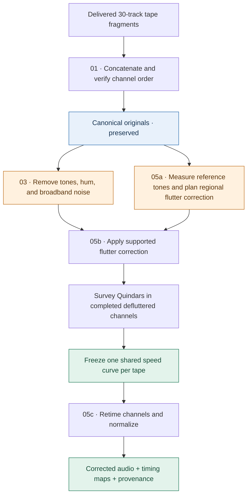
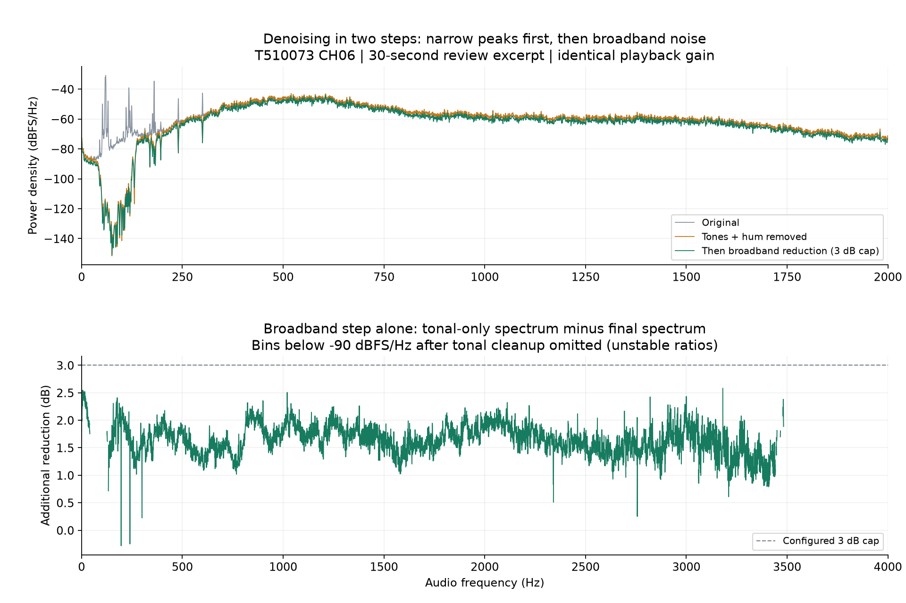
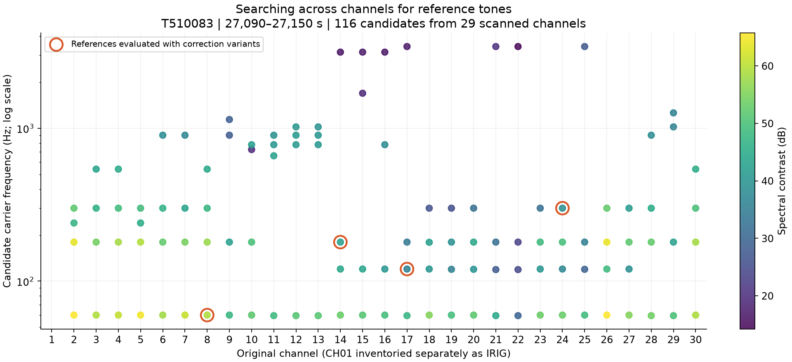
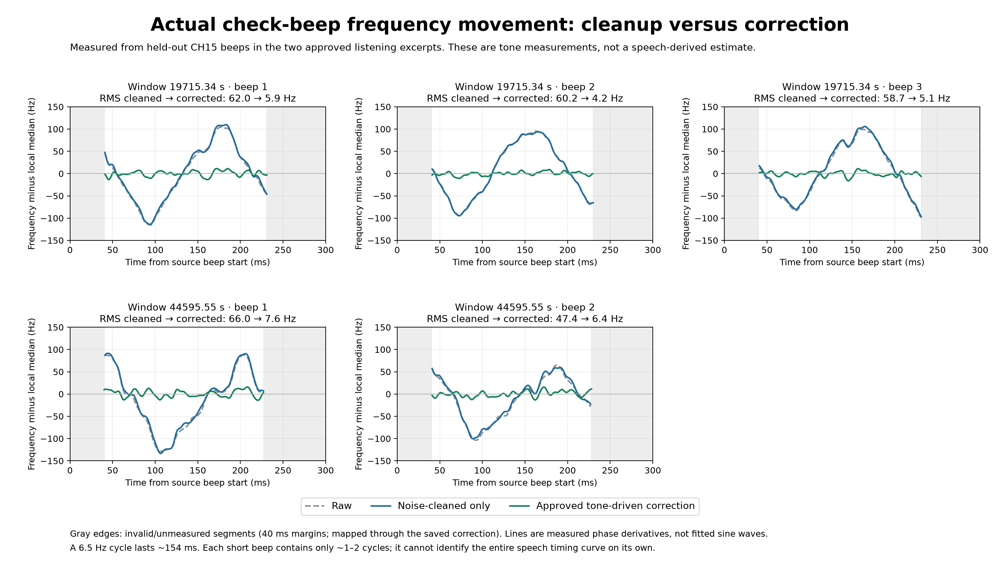
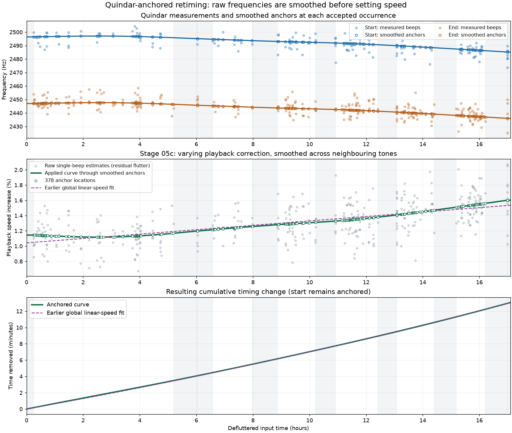
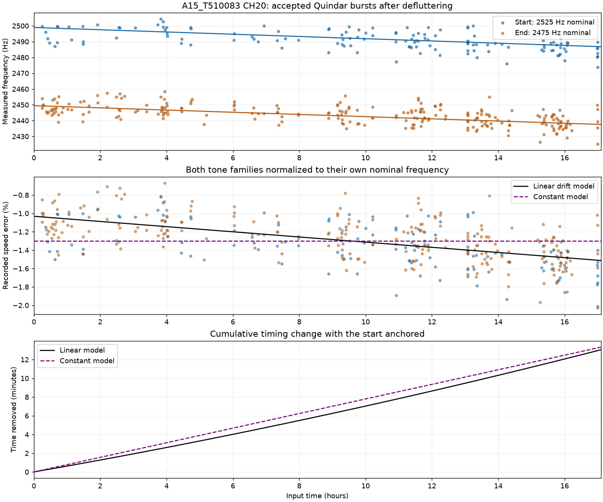

# Apollo 15 30-track audio processing pipeline

This repository contains the processing pipeline for the **30-track audio recordings of the Apollo 15 mission**. It assembles delivered fragments into continuous channels, reduces tonal and broadband noise, corrects tape flutter, and retimes the resulting audio using Quindar tones.

The aim is to improve intelligibility while preserving the voices and character of the historical recordings. Original audio stays separate from processed outputs. Source audio, generated reports, listening samples, and processing runs are not distributed in this repository.

## From tape fragments to corrected audio



### 1. Assemble the channels

Each tape arrives as channel fragments. Stage 01 checks their order and joins them into continuous channel files. These canonical originals remain the reference for subsequent processing.

### 2. Reduce interference

Stage 03 removes persistent narrowband tones and residual hum, then reduces broadband noise by at most 3 dB. It saves reusable denoised channels so later timing work does not require repeating cleanup.

Noise reduction and timing correction solve different problems: removing hum does not repair pitch fluctuations caused by uneven tape speed. The cleaner identifies signal characteristics, not the historical origin of noise, so listening review remains part of assessing speech preservation.



**Read the upper plot in three steps:** grey is the original spectrum, orange is after tonal/hum cleanup, and green adds the 3 dB-capped broadband step. The large narrow peaks at low frequencies are strongly reduced by tonal cleanup; the broadband step makes a smaller change across the spectrum. The lower plot isolates that additional change. Bins below -90 dBFS/Hz after tonal cleanup are omitted there because ratios near the noise floor are unstable.

This is a 30-second T510073 CH06 review excerpt, starting 1,260 seconds into its delivery fragment, from the 2026-10-17 speech review. All three versions use identical gain. The plots are Welch power-spectrum estimates of the saved review variants, not a new processing run. They illustrate the two operations, not proof of speech preservation or the historical origin of the removed noise.

### 3. Correct local flutter

Flutter is rapid variation in playback speed: a steady recorded tone wobbles in frequency, and speech is distorted along with it. Stage 05a searches the original channels for usable reference tones and chooses correction methods region by region. It records where the evidence supports transferring a correction to another channel and where it does not.

Stage 05b applies supported timing maps to the denoised audio, joining regional curves continuously. The separate reference branch in the diagram matters: cleanup can remove the very tones needed to measure flutter.

#### Find candidate references across the tape's channels



This regional audit of **T510083, seconds 27,090–27,150**, retained 116 candidate tones across 29 scanned channels; CH01 was inventoried separately as IRIG. Each dot is a candidate carrier frequency. Color shows how strongly the spectral peak stands above its surroundings. Orange rings identify the four references evaluated with correction variants: CH08 at 60 Hz, CH14 at 180 Hz, CH17 at 120 Hz, and CH24 at 300 Hz.

A strong peak is only a candidate. The planner also checks tracking support, compares correction methods on calibration events, and tests the selected correction on separate events. In this audit, CH22 passed the numeric transfer checks using the CH08 60 Hz reference with signed-frequency tracking over a 2–30 Hz modulation band. The other targets still required transfer validation. These are local decisions, not a blanket approval to correct every channel.

**Carrier frequency and flutter rate are different:** a tone at hundreds of hertz can wobble several times per second. The first locates the reference in the audio spectrum; the second describes the timing error being estimated.

#### Measure whether the correction actually steadies another tone



In this separate **T510077 CH30 → CH15** research example, grey and blue traces nearly overlap: denoising alone leaves the check tones' frequency wobble. Green shows their measured frequency after reference-tone correction. Across the five illustrated beeps, RMS variation drops from roughly **47–66 Hz to 4–8 Hz**.

These are measured frequency trajectories relative to each beep's local median, not fitted sine waves. The correction came from the separate CH30 reference; the plotted CH15 beeps check its effect. The two source excerpts received local listening approval. Their short check tones and successful examples do not establish full-tape transfer or speech quality everywhere. This historical research comparison used a 6 dB broadband cap; today's stage-03 default and the denoising figure above use 3 dB.

### 4. Correct slow speed drift with Quindar tones

After defluttering, the short Quindar signaling tones provide observations of slower playback-speed error. The analysis compares the two tone families with their nominal frequencies, smooths the noisy observations, and integrates the estimated speed curve into a continuous timing map. Speech and pauses between tones follow the same map.



**Reading the graph, from top to bottom:**

1. **Measure the tones.** Blue and orange points show the two Quindar families. Faint points are individual measurements; open circles mark smoothed anchors. Their downward trend indicates increasingly slow playback relative to nominal tone frequencies.
2. **Estimate the correction.** The green curve converts those observations into a varying playback-speed increase. Smoothing avoids treating every noisy measurement as a real speed change. The dashed purple line is the earlier linear baseline.
3. **Integrate the timing change.** A small speed adjustment accumulates over hours. The start stays anchored while the corrected end moves earlier. Grey bands mark sparse coverage or unsupported edges, where the curve is modeled rather than directly measured.

#### Worked example: A15_T510083, channel 20

These charts come from the local single-channel assessment dated **2026-10-17**. They illustrate the method; they are not a completed tape-wide calibration or a mission-wide quality claim.

| Measurement | Sample result |
| --- | --- |
| Quindar candidates / accepted anchors | 737 / 378 |
| Playback-speed increase | Approximately 1.117% to 1.601% |
| Duration before retiming | 17:05:40.960 |
| Duration after retiming | 16:52:37.074 |
| Accumulated time removed | 13 minutes, 3.887 seconds |
| Held-out tone prediction RMSE | 4.96 Hz |

The selected smoothing scale was 120 minutes; anchors still occur at each accepted tone. This broad smoothing reflects substantial residual scatter. Retiming changes both duration and pitch. Unknown historical generator accuracy, residual flutter, and gaps in tone coverage limit absolute clock accuracy.

The production tape-wide workflow surveys all expected completed defluttered audio channels before freezing **one shared curve per tape**, including for channels without usable tones. Historical content offsets between recording heads are retained.

<details>
<summary>Earlier comparison: fixed speed versus gradual drift</summary>



A single fixed multiplier captures the overall speed error, but misses the trend across the recording. The earlier linear model reduced held-out tone RMSE from 6.17 Hz to 5.02 Hz. The smoothed anchored curve above is the later approach; this chart is retained to explain the progression, not as a second applied correction.

</details>

Only static measurement charts are included here. No Apollo 15 recordings or listening clips are included in the repository.

## Setup

Use Python 3.10 or newer and `uv`. Dependencies are declared in `pyproject.toml` and pinned in `uv.lock`. Run commands from the repository root.

```powershell
uv sync --locked
uv run python scripts/pipeline.py --help
```

## Pipeline

| Stage | Script | Purpose |
| --- | --- | --- |
| 01 | `scripts/01_concatenate.py` | Verify fragment order and concatenate each channel. |
| 03 | `scripts/03_denoise.py` | Remove persistent tones and residual hum, then apply broadband reduction capped at 3 dB. |
| 05a | `scripts/05a_plan_deflutter.py` | Analyze original channels and save regional flutter correction plans. |
| 05b | `scripts/05b_deflutter.py` | Apply supported timing corrections to denoised audio, then bounded constant-gain normalization. |
| 05c | `scripts/05c_retime.py` | Apply a shared tape speed curve derived from Quindars in completed defluttered audio. |

Stage numbers reflect the project's development history. Tonal and broadband cleanup are now combined in stage 03. `scripts/01a_zip_originals.py` is a separate utility for archiving complete concatenated tapes as ZIP files.

The whole-channel order is **03 -> 05a -> 05b -> 05c** after concatenation. Stage 05a reads original channels because denoising can remove useful timing references. Stage 05b reads denoised intermediates and saved plans.

### Data locations

Defaults reflect the local processing workstation, under `D:/Apollo_15_30-Track`. Supply overrides for another machine.

| Folder | Contents | Pipeline override |
| --- | --- | --- |
| `orig_delivery/` | Delivered fragments | `--delivery` |
| `orig_concatenated/` | Canonical per-tape, per-channel originals | `--concatenated` |
| `denoised/` | Reusable stage-03 intermediates | `--denoised-root` |
| `deflutter_planning/` | Regional plans, evidence, and timing maps | `--flutter-planning-root` |
| `defluttered/` | Stage-05b audio | `--defluttered-root` |
| `quindar_post_deflutter_analysis/` | Quindar surveys and frozen shared plans | `--quindar-analysis-root` |
| `defulterred_retimed/` | Stage-05c audio | `--retimed-root` |

The spelling `defulterred_retimed` is the existing output directory name. Logs and manifests go under local `runs/<run-id>/` by default; `--output` changes that location. Standalone scripts may use different option names; consult their `--help`.

## Running the pipeline

Preview commands without starting processing:

```powershell
uv run python scripts/pipeline.py plan --stages 03 --all-tapes
```

Denoise every available channel on every canonical tape:

```powershell
uv run python -u scripts/pipeline.py run --stages 03 --all-tapes --plain
```

This includes channel 1 and IRIG-labeled channels. Full-mission denoising is a long-running batch job. `--denoise-workers` controls concurrency; the pipeline default is 14. Avoid launching a second job against outputs already being processed.

For one channel:

```powershell
uv run python scripts/pipeline.py run --stages 03 --tape A15_T510083 --channel 20 --plain
```

Completed intermediates are retained across runs and verified against source identity, cleanup code/settings, frame count, and decoded audio hashes. Interrupted cleanup restarts in temporary storage. Cleanup-code changes can trigger reprocessing, so keep the implementation and environment stable during a batch.

### Plan and apply flutter correction

Plan a tape from its canonical originals, then render one denoised channel:

```powershell
uv run python scripts/pipeline.py run --stages 05a --tape A15_T510083 --plain
uv run python scripts/pipeline.py run --stages 05b --tape A15_T510083 --channel 20 --plain
```

Planning checkpoints completed regions and reuses matching completed plans. Interrupted plans can resume; incompatible source data, settings, or evidence are rejected. `--flutter-plan-workers` controls planning concurrency.

Plans distinguish supported corrections, regions requiring transfer validation, and regions to leave uncorrected. Whole-channel rendering joins regional timing curves continuously. `--experimental-transfer` allows proposed corrections in regions requiring transfer validation for listening review; those results remain experimental. A local listening-approved example does not validate every channel or an entire tape.

### Retime a completed tape

Finish stage 05b for every expected audio channel of a tape before its Quindar survey. IRIG-only channels are excluded from this readiness check because stage 05b does not render them.

```powershell
uv run python scripts/quindar_survey.py --tape A15_T510083 --workers 8
uv run python scripts/05c_retime.py --tape A15_T510083 --plan-only
uv run python scripts/pipeline.py run --tape A15_T510083 --all-channels --stages 05c --plain
```

The survey measures completed **defluttered audio**, not original audio. Planning freezes one shared speed curve per tape, used by all channels, including those without usable tones. Retiming changes duration and pitch, preserves historical content offsets between heads, and records timing/provenance information. Sparse tone coverage, residual flutter, and unknown historical generator accuracy limit absolute calibration.

## Repository contents

- `scripts/`: pipeline stages, shared processing code, and review utilities. `noise_review.html` is the template loaded by `review_noise_reduction.py`, so it is required source.
- `configs/`: processing decisions and example configurations. Examples can reference local audio and reports; adapt those paths to your data.
- `tests/`: automated checks for processing, orchestration, and file handling.
- `docs/images/`: static measurement charts only. Quindar charts come from `reports/quindar_speed_T510083_CH20_20261017/review/`; the check-tone validation chart comes from `reports/nested_cleanup_20261017/heldout_beep_frequency_motion.png`. No recordings or HTML players are copied.
- `docs/render_readme_charts.py`: reproduces the denoising and reference-search figures from local `reports/noise_review_20261017_speech/` and `reports/regional_deflutter_T510083_audit/r00000.json`. Requires those ignored reports and Matplotlib; exports PNGs only.
- `research/irig_free_20261016/`: experimental Python tools and their holdout configuration. These are research source, not production stages; some require local reports, data, or additional plotting dependencies.

Git ignores generated `reports/`, `runs/`, historical experiment `archive/`, research snapshots, audio, numerical artifacts, and Python environments/caches. These files remain available locally. The historical `IRIG_FREE_FLUTTER_RESEARCH.md` report is also local-only; it contains experiment history and references to excluded artifacts.

## Validation

```powershell
uv run python -m unittest discover -s tests -v
```

Listening review remains necessary to assess speech preservation and correction quality. Numeric improvements alone do not establish that a method works across the mission.
