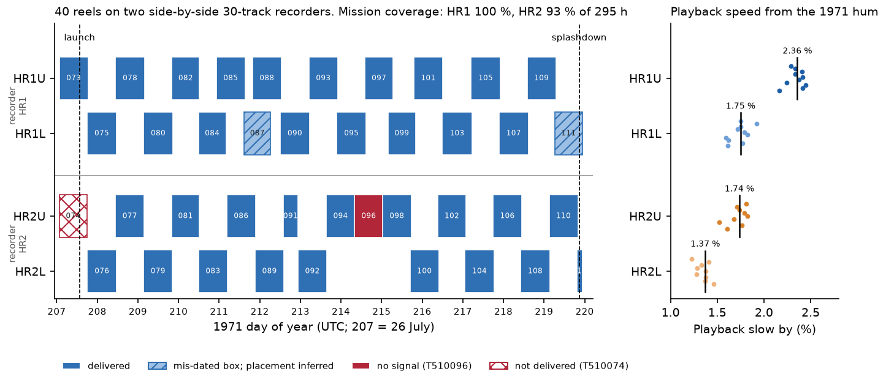
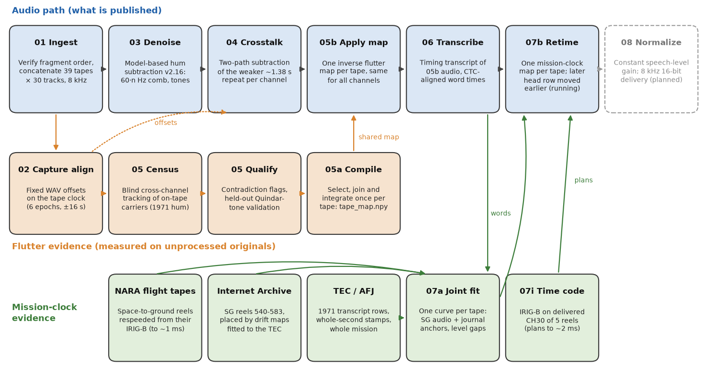
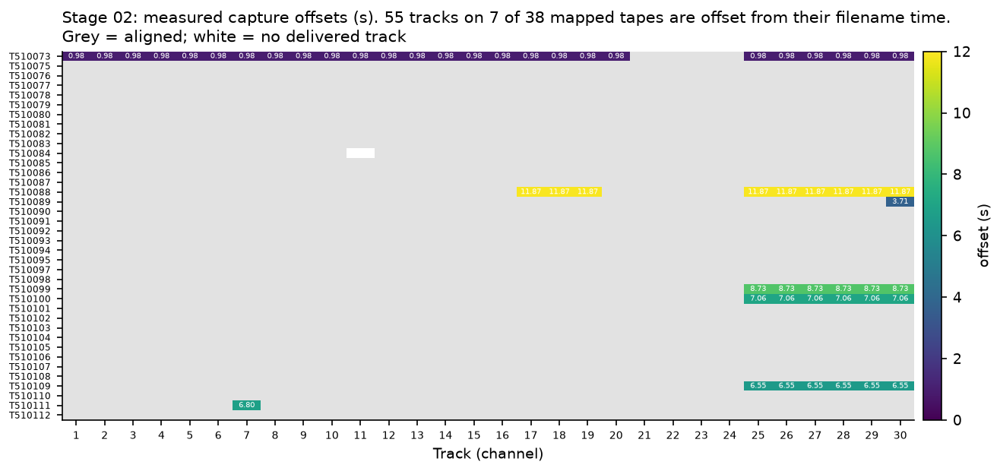
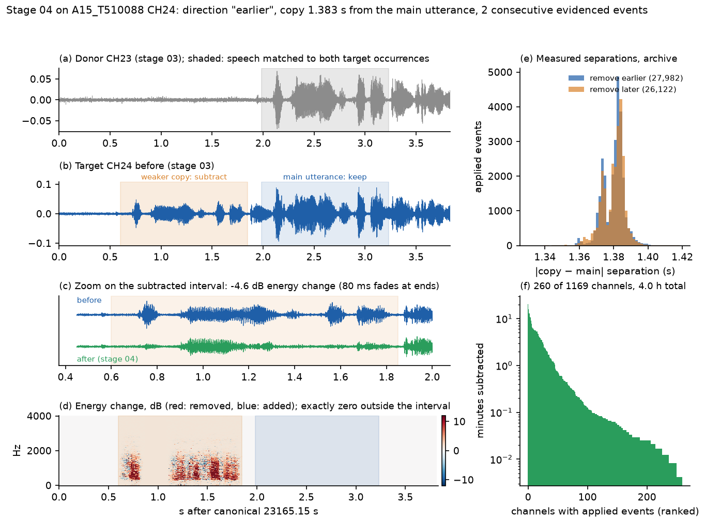
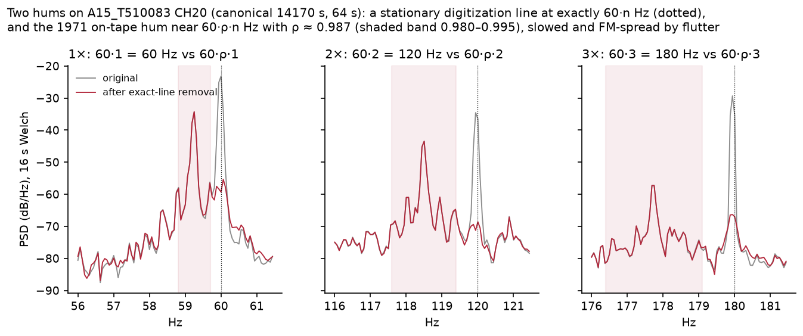
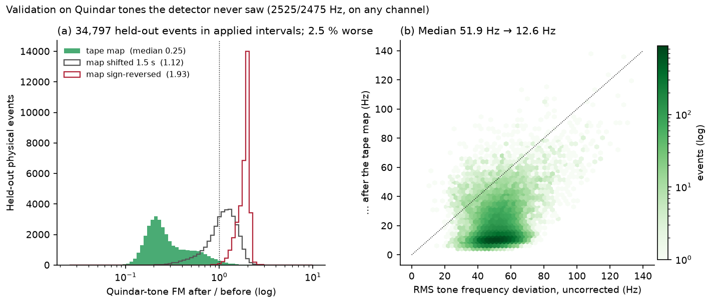

# Restoring the Apollo 15 Mission Control 30-track recordings: hum subtraction, crosstalk removal and shared-tape flutter correction

**Status, November 2026.** Stages 01–05 have been run across the archive. Stage 06
(the timing transcript of the stage-05b audio) is complete. It places each tape on mission
time through stage 07a (the fit against the retimed space-to-ground reels) and 07b
(retiming). Stage 08 then writes the 8 kHz 16-bit delivery files. The one-page
[pipeline overview](docs/00_pipeline_overview.md) lists every stage, its data and its format. All numbers below come from
the published archive records under `D:/Apollo_15_30-Track`, and all figures are
regenerated from those records by `research/readme_figures/` (Appendix A).

---

## Executive summary

Apollo 15 Mission Control recorded its voice loops on **two side-by-side 30-track
recorders, HR1 and HR2**: 60 simultaneous tracks of flight-controller loops,
air-to-ground and network audio for the whole mission. Each recorder alternated
between an upper and a lower head stack, changing reels about every 17 hours with a
roughly 30-minute overlap. The mission ran 295 hours from launch (26 July 1971,
13:34 UTC) to splashdown (7 August, 20:46 UTC) and filled **40 reels**, about
**19,700 track-hours** of audio.



**Figure 1.** The 40 reels on the mission timeline (filename clock, 1971 day of year).
Hatched blue reels have mis-dated boxes and are placed provisionally (E.6).
*Right:* playback speed of each digitized reel, from about 40 peak measurements per
reel of the 1971 hum at 60·ρ·n Hz after exact-line removal.

| Measure                                         | HR1            | HR2            | Total                  |
| ----------------------------------------------- | -------------: | -------------: | ---------------------: |
| Reels recorded                                  | 20             | 20             | 40                     |
| Reels delivered with program audio              | 20             | 18             | 38                     |
| Usable track-hours                              | 10,139         | 8,536          | 18,675 (94.8 %)        |
| Track-hours missing                             | 0              | 1,014          | 1,014 (5.2 %)          |
| Mission time covered, launch to splashdown      | 100 %¹         | 93.0 %         | 60 tracks: 93.0 %      |

¹ Includes T510087 and T510111, whose boxes carry impossible dates (§E.6). Their
placement is inferred and remains provisional. Without them, HR1 covers 93.9 %.

The digitized tapes posed a series of problems. Each one either required a new
technique or determined how the processing had to be ordered.

**E.1 No time code; the channel numbers are wrong.** Track 1 should carry the IRIG
time code. Because the digitization team set up the tape alignment incorrectly, it was
not captured. The same misalignment means the delivered channel identifiers are wrong:
each is offset from the true track by a number still to be determined. Later
investigation and processing steps will establish that offset. Until then, every
channel number in this document refers to the *delivered file numbering*.

**E.2 A new way to de-flutter.** The tapes flutter: their speed wobbles about 2 % RMS
at 2–30 Hz (6.4 Hz dominates in the window of Figure 7), which warbles every voice
and tone.
Correcting flutter requires a steady carrier recorded on the same tape, and IRIG would
have been the obvious one. Without it, and with Quindar tones too sparse and present only
on some tracks, we developed a **blind, check-tone-free method** (§6). It finds every
faint carrier on every track, demodulates each one independently, and keeps only the
motion that independent tracks of one tape agree on at zero lag. Because all 30 tracks
share one moving tape, the agreed motion becomes **one timing map per tape**, applied
identically to all 30 tracks. On about 34,800 Quindar tones the method never saw, it cuts
the median frequency wobble from 52 Hz to 13 Hz. It corrects 85 % of the 623 tape-hours
and leaves the rest untouched rather than guessing.

**E.3 Digitization hum far louder than the signal.** The playback machine was not
grounded during digitization. It injected 60 Hz mains hum and a full comb of harmonics
up to 3.9 kHz, and this hum is often much stronger than the program. On sampled minutes,
the hum carries a median **8×** the power of everything else on the track, and over
**50×** in a quarter of them. At 180 Hz the digitization line is a median **700×**
(28.5 dB) stronger than the faint 1971 hum line that flutter tracking relies on. Our
answer is **model-based hum subtraction** (§4), rather than notch filtering or
broadband denoising. A phase-locked model of each line is fitted on quiet audio,
accepted only if it validates on separate held-out audio, gated off where the line
vanishes, and subtracted. Speech and hiss away from the 60 Hz grid are left intact
(Figure 4).

**E.4 Slow, miscalibrated tape machines, and a lucky consequence.** The playback machine was not
restored to proper working order and runs slow. The hum recorded in 1971 should replay
at 60 Hz, but it appears at 58.5–59.3 Hz, so the digitized tapes play **1.2–2.5 %
slow**. The per-head medians are 2.4 % (HR1U), 1.75 % (HR1L), 1.74 % (HR2U) and
1.37 % (HR2L) (Figure 1, right). A 17-hour reel therefore plays roughly 12–25 minutes
long. These figures assume the 1971 mains ran at its nominal 60 Hz. This is a timing
error that stage 07 must correct against mission time.

*Each 1971 transport ran at its own speed.* The speed error is not one common number.
Each head group carries its own error, steady over the 9–10 reels it recorded across
the 13-day mission:

| Group | Reels | Median slow | Range         | Reel-to-reel SD |
| ----- | ----: | ----------: | ------------: | --------------: |
| HR1U  |    10 |      2.36 % | 2.17–2.45 %   |          0.09 % |
| HR1L  |    10 |      1.75 % | 1.59–1.92 %   |          0.10 % |
| HR2U  |     9 |      1.74 % | 1.52–1.82 %   |          0.10 % |
| HR2L  |     9 |      1.37 % | 1.22–1.46 %   |          0.07 % |

The upper and lower decks of the same recorder differ by 0.6 (HR1) and 0.4 (HR2)
percentage points, four to six times the reel-to-reel scatter. The measured hum
frequency is the ratio of playback speed to record speed. A fault in the digitization
playback alone would shift every reel by the same amount. An offset that follows the
1971 deck, reel after reel, points to the original transports: **each was slightly
miscalibrated, by its own amount**. The playback machine's slowness is a shared factor
on top of that. Until the digitization logs are checked, it remains possible that each
group was digitized on a separate playback setup.

With IRIG on track 1 (E.1), this would have been routine to find and correct. The
time code encodes true seconds, so its replay rate on each reel would give that reel's
absolute speed directly, and would separate record-speed from playback-speed error.
Without it, the 1971 hum is the only speed reference on the tapes. Stage 07 will
calibrate the speed against mission time, and the per-deck structure helps there. A
few constants, one per transport, should explain every reel in its group. A reel that
breaks from its group's speed is an immediate flag for a mislabelled head, a mis-dated
box (E.6) or a change of machine.

*The lucky coincidence.* The tapes carry two mains hums:

- **The 1971 hum.** It was picked up when the loops were recorded, so it sits *on the
  tape* and moves with the tape. Every wobble of the transport frequency-modulates it,
  which makes it a flutter witness present on almost every track. This is the signal
  E.2 needs.
- **The digitization hum.** It came from the ungrounded playback machine in the
  present day and was added *after* the tape heads, at exactly 60·n Hz. It is perfectly
  steady, ignores tape motion, carries no flutter information, and is much louder: a
  median 11 dB above the 1971 line at 60 Hz and 28 dB (about 700×) at 180 Hz (E.3).

Had the tapes been replayed at the correct speed, both hums would sit on exactly the
same frequencies. The weak 1971 line would then be buried under the strong modern
one. Removing the modern line would also remove the steady part of the 1971 line
underneath it, and what remained of the 1971 hum could not be separated from the
residue of that subtraction. The flutter witness would have been lost.

The miscalibration moves them apart. Because the tapes replay 1.2–2.5 % slow, the
1971 hum comes out at 58.5–59.3 Hz instead of 60 Hz. That is 0.7–1.5 Hz below the
digitization line at the fundamental, 2–4.5 Hz below it at 180 Hz, and further at
higher harmonics. The census removes the modern lines with a fit only about 1/16 Hz
wide: their frequency is measured to a fraction of a 0.06 Hz bin and fitted over 16 s
blocks. It can therefore delete the 60·n Hz lines almost completely while leaving the
1971 lines, at least 11 bins away and more at higher harmonics, untouched (Figure 6). In short, the defect
that corrupts the timing (E.4) also keeps the one signal that lets us repair the
flutter (E.2) clear of the defect that corrupts the sound (E.3).

**E.5 Tracks captured with time offsets.** The crosstalk work revealed that some
tracks were offset in time from the rest of their tape. The digitizers had started
recording some channels before others, or the recording software had introduced an
equivalent offset. 55 tracks on 7 tapes are offset by 0.98–11.87 s. Stage 02 now
measures these offsets from cross-track matches at independent points along each reel,
and every later stage uses them (§3, Figure 3).

**E.6 Missing, empty and mislabelled reels.**

- **T510074** (HR2U, launch day 01:30–18:05 UTC) was photographed but never
  delivered as audio.
- **T510096** (HR2U, 3–4 August) is a forgery with no signal. All 30 delivered files
  are byte-identical and contain no program audio, so the reel is effectively missing
  from the archive.
- Together, these two leave **20.6 mission hours** with no HR2 audio, including
  4.5 hours after launch: **1,014 track-hours**, 5.2 % of the recorded audio.
- **T510087** and **T510111** carry box dates of 7 July and 7 May 1971, and box
  durations that contradict the digitized length. Their start times fit the HR1
  handover sequence exactly (a 14:53 start just before T510085 ends; 06:25 just before
  T510109 ends). We place them provisionally on 30 July and 7 August, pending
  confirmation in stage 07.

**Where things stand.** Stages 01–05 are complete. All 1,169 delivered tracks have
been hum-subtracted and crosstalk-processed, and the 1,139 tracks of the 38 reels with
signal have been de-fluttered with their tape's shared map. Stage 06 is now
transcribing that audio to locate exchanges in the 1971 mission transcripts and other
recordings. That will put each reel on mission time, so that stage 07b can remove the
slow-playback error (E.4), and it will provide evidence for resolving the channel
numbering (E.1).

---

## Abstract

The Apollo 15 Mission Control recordings consist of 40 analogue reels from two
30-track recorders, each reel carrying 30 simultaneous tracks of voice loops and
air-to-ground audio. 39 reels were digitized as 8 kHz mono WAVs, 1,169 numbered tracks
in all. Three defects limit their usefulness:
(i) mains hum, introduced both in 1971 and during digitization, (ii) a delayed
copy of speech leaking into neighbouring tracks, and (iii) tape flutter, a 2–30 Hz
speed modulation of about 2 % RMS that audibly warbles every tone and voice. We describe
a provenance-bound pipeline that subtracts hum with validated line models and removes
evidenced repeats with a two-path adaptive model. It then measures the flutter
*blindly*, with no check tones as input, as the motion that independent tracks of one
tape agree on, using the 1971 mains hum recorded on the tape as the main witness.
One timing map per tape is qualified, compiled and applied identically to all of its
tracks. Over 623 tape-hours on 38 tapes, the map corrects 85.0 % of tape time and
bypasses the rest. On about 34,800 held-out Quindar-tone events never seen by the
detector, median tone frequency deviation falls from 51.9 Hz to 12.6 Hz: a median ratio
of 0.25, with 2.5 % of events worse. The sign-reversed map makes the same events worse
(ratio 1.93), as does the map shifted by 1.5 s (1.12). Results on the 16 tapes withheld
from development match those on the 22 development tapes.

---

## 1. Source material and coordinate system

Each tape (`A15_T5100xx`/`T5101xx`) holds up to 30 tracks recorded **simultaneously on
one moving tape**. This physical fact governs the method. Hum, flutter and dropouts
are properties of the tape transport, so one tape-motion correction exists at each
instant and applies to every track. A track without usable tones still receives the
correction measured on its neighbours.

| Quantity                     | Value                                                                                          |
| ---------------------------- | ---------------------------------------------------------------------------------------------- |
| Tapes delivered              | 39 of 40 (T510073–T510112; T510074 not delivered)                                              |
| Recorders                    | HR1 and HR2, alternating upper (U) and lower (L) head stacks; the head is in each filename     |
| Numbered tracks              | 1,169 (T510084 has no CH11)                                                                    |
| Format                       | mono WAV, 8 kHz, one file per track after stage 01                                             |
| Tape duration                | 3.4–17.7 h; 623.0 h on the 38 tapes processed by stage 05                                      |
| Excluded from flutter stages | T510096: 30 byte-identical files without program audio (E.6)                                   |
| Channel numbers              | As delivered. They are offset from the true tracks (E.1), and CH01 holds no IRIG time code    |

**Canonical tape time.** Every track is placed on its tape's clock using the time range
in its filename. The time `t` of a sample is the WAV time plus the track's
`start_seconds`. All stages preserve the frame count, sample rate and offset of each
track, and every stage-04/05 record is expressed in canonical tape seconds. This is a
filename timeline, not authenticated mission time (GET). Anchoring to GET is the purpose
of stage 07.

---

## 2. Pipeline overview



**Figure 2.** Processing stages. The audio path (blue) produces the published WAVs.
The timing-evidence path (orange) is measured **on the unprocessed originals**,
because denoising deliberately removes the tones that carry the timing evidence. The
two paths meet only at stage 05b, where the qualified tape map is applied to the
stage-04 audio. Dashed boxes are in progress or planned.

| Stage | Entry point (`scripts/30-track/`)      | Function                                                                  | Archive state                                                    |
| ----- | -------------------------------------- | ------------------------------------------------------------------------- | ---------------------------------------------------------------- |
| 01    | `01_ingest/01_concatenate.py`          | Verify fragment order and continuity; assemble one WAV per track          | Done; originals ZIP-archived by `01a_zip_originals.py`           |
| 02    | `02_alignment/02_align_capture.py`     | Measure fixed capture offsets between tracks                              | Done; 7 tapes corrected                                          |
| 03    | `03_denoise/denoise_v2_console.py`     | Model-based hum subtraction, `apollo15-hum-subtraction-v2.16`             | Done; 1,169 tracks                                               |
| 04    | `04_crosstalk/04_crosstalk.py`         | Subtract evidenced, weaker ~1.38 s repeats                                | Done; 1,169 tracks, 260 with subtraction                         |
| 05    | `05_deflutter/05_detect_flutter.py`    | Blind cross-track tape-motion census on originals                         | Done; 38 tapes                                                   |
| 05    | `05_deflutter/05_analyze_flutter.py`   | Assessment, follow-up, qualification, held-out validation                 | Done; validation passed                                          |
| 05a   | `05_deflutter/05a_plan_deflutter.py`   | Compile one timing map per tape                                           | Done; 38 maps in `deflutter_maps/`                               |
| 05b   | `05_deflutter/05b_deflutter.py`        | Apply the tape map to every stage-04 track                                | Done; 1,139 tracks in `defluttered_shared/`                      |
| 06    | `06_transcribe/06_transcribe.py`       | Timing transcript of 05b audio (shared engine in `00_common/`)            | Done; words CTC-aligned ([runbook](docs/15_2026-11-22_transcription_runbook.md)) |
| 07a   | `07_retime/07a_sg_retime.py`           | SG anchors (IA, NARA) and one joint curve per tape, as shared-layout plans; needs the retimed SG set | Next ([SG retiming](docs/20_2026-11-25_sg_retime_30track.md)) |
| 07b   | `07_retime/07b_retime.py`              | Apply the tape plan to every track; write the 06 transcript on the output clock | Planned |
| 08    | `08_normalize/08_normalize.py`         | Constant gain to a speech-level target; 8 kHz 16-bit dithered delivery WAV | Planned ([guide](docs/05_2026-11-13_speech_normalization.md))    |
| 09    | `09_irig/irig_search.py`               | Standalone IRIG time-code search                                          | Not integrated                                                   |

The order is fixed. Hum is subtracted first, because it would otherwise dominate the
crosstalk fit. Crosstalk is subtracted before de-flutter, so that measured
donor/main/repeat delays keep their source coordinates. Retiming and level setting
follow.

Five rules apply throughout:

1. **One tape, one motion.** Evidence may come from any track. Selection, joining and
   application happen once per tape. No per-track map is fitted or anchored.
2. **Measure on originals; correct on processed audio.**
3. **Bypass rather than guess.** Intervals without qualified evidence keep zero local
   correction. Gaps are never extrapolated. Partial correction is acceptable.
4. **Validate on held-out events.** Quindar tones never enter the detector and serve
   only as an independent audit.
5. **Immutable provenance.** Every output records SHA-256 bindings to its inputs,
   code and settings. Changed code or settings produce a new run ID and destination,
   never an overwrite.

---

## 3. Ingest and capture alignment (stages 01–02)

Stage 01 groups delivered fragments by tape, head and channel. It refuses reversed,
overlapping or gapped time ranges, then concatenates the samples without
modification.

Some tracks of a tape were captured with a constant start delay relative to their
filename time (E.5). The delays were first noticed as inconsistent donor delays during
the crosstalk research. Stage 02 now measures them on the originals. It takes 48 s spans at
six epochs spread across the reel (4–96 % of its length) and resamples them to 2 kHz.
The spectra are whitened in 250–920 Hz with exact 60·n Hz bins excluded, then
cross-correlated over ±16 s. A peak counts only if it is at least 12 times the RMS
correlation and 1.3 times the next-best peak. Identical files count as one reference.
A track's lag must be measured at ≥ 3 epochs, including one in each third of the reel,
and all must agree within 3 ms. A speech delay alone could be a routed feed or an
echo, so a nonzero offset is accepted only when the independent file boundaries agree
with it: the difference in file end times must match the lag within 3 ms. Ambiguous
tracks are rechecked at the native rate in the 1350–3400 Hz band at five further
epochs. Tracks that remain unresolved hold the tape for review.



**Figure 3.** Measured capture offsets. 55 tracks on 7 tapes are displaced by
0.98–11.87 s from their filename time, usually in blocks of adjacent tracks. Stage 04
uses these offsets to find donors, and stage 05 uses them to place every track on the
common tape clock. The audio itself is never shifted.

---

## 4. Hum subtraction (stage 03)

### 4.1 Model

The recordings carry two families of mains interference (§6.1). Stage 03 removes
stationary and slowly varying line components by subtracting a fitted model. It does
not filter or spectrally gate broadband noise, so comm hiss and the original timing
are preserved. The model (`scripts/30-track/03_denoise/runtime/scripts/denoise_v2.py`, frozen by
hash) is estimated at anchors every 64 s. Each anchor fits ±68 s of original audio, and
adjacent anchor models are cross-faded with a raised cosine. Within each anchor:

1. **Training and validation frames.** Fits use 0.5 s frames whose 350–2500 Hz
   (speech-band) level is in the quietest 35 %. Alternating 2 s blocks provide
   training and validation, so every component is accepted on audio it was not
   fitted to.
2. **Phase reference.** The strongest persistent harmonic is chosen as a phase
   reference, preferring harmonics at or above the 50th (3 kHz, above the speech
   band). It is demodulated with a 1 Hz envelope. The reference is bridged over short
   dropouts (≤ 1.25 s) and tapered off where it loses confidence.
3. **Phase-locked comb.** Harmonics 3–65 are synthesized from the reference phase
   divided by its harmonic number. Each component is kept only if its robust complex
   coefficient has coherence ≥ 1.2 and improves the validation frames by ≥ 3 dB. A
   per-component gate turns it off where the line is persistently absent.
4. **Low hum.** 60 Hz and 120 Hz are modelled separately as 4 Hz-bandwidth envelopes.
   They are applied only where the line stands above the neighbouring floor, and
   120 Hz also requires 60 Hz or upper-comb support, so that a voiced fundamental is
   not followed.
5. **Other lines.** Additional stationary tones come from saved per-track frequency
   hints (`stage_evidence/denoise/frequency_hints`) and must pass the same validation.
   A *shifted comb* handles a second, slightly detuned mains comb: harmonics 10–65
   whose fundamental is offset from 60 Hz by a stable 0.012–0.04 Hz. It needs ≥ 5
   supported harmonics spanning ≥ 8 harmonic numbers.
6. **Residual refinement.** Two passes revisit up to 24 residual candidates. A compact
   ±50 ms projection bank is then applied once, after baseline blending, for
   persistent low residuals.

Every anchor writes a record of its components, coherences, validation gains and
gated intervals (`cleanup.jsonl`, about 1,900 anchors for a 17 h track). The first
stage-03 releases (263 tracks, on T510073–T510083) applied one constant peak gain per
track: −3 dBFS target, +12 dB cap, ignoring isolated endpoint impulses. The other 906
tracks were written at unity gain. Stages 04 and 05b retain that gain, and stage 08
will set the final speech level.


**Figure 4.** Stage 03 on T510083 CH20, a passage with a known late-hum recurrence.
(a, b) Spectrograms before and after. (c) Long-term spectra. The subtracted model
(orange) is a pure line spectrum on the 60 Hz grid. (d, e) Low and high detail. At
the 60·n Hz grid the median level falls by 25.4 dB, and the median change off the grid
is 0.02 dB. The notches about ±10–20 Hz wide in (d, e) show that the time-gated line
models also attenuate speech and noise energy where it overlaps an established hum
line. The project owner accepted this trade-off in listening review
([findings](archive/docs_retired_20261126/01_2026-11-11_denoise_v2_plan.md)).

---

## 5. Crosstalk removal (stage 04)

### 5.1 Phenomenon

Many tracks carry, besides their own audio, a weaker copy of speech that appears in
another track about 1.38 s earlier or later. An interchannel match at that delay is not
enough to prove a repeat. Adjacent tracks may legitimately monitor the same source, and
such a track remains a valid reference. Stage 04 therefore requires the repeat to be
established **within the target track**. It removes only the weaker occurrence and
always keeps the main utterance.

### 5.2 Method

The donor is always a completed stage-03 track, read at the signed start difference
from stage 02, so the order of processing cannot change results.

- **Discovery.** Successive 0.25 s target windows are searched for another occurrence
  0.8–1.9 s later, first coarsely (310–890 Hz, 2 kHz), then at the native rate
  (320–2850 Hz) with fractional lag. A candidate needs a neighbouring window at a consistent delay,
  matching energy in several speech bands, and a distinct donor. Both target
  occurrences are matched independently to the same donor occurrence over signed
  offsets.
- **Qualification.** Stationary 60 Hz harmonics are removed from the analysis
  excerpts. Periodic signals are rejected by comparison with shifted controls. Each new
  interval needs two independently observed speech minutes on the same tape, within
  30 minutes and within 15 ms of the measured separation.
- **Direction.** For each track of each tape, the stage decides once whether the
  earlier or the later copy is removed. Each minute votes by the donor-matched level of
  the two occurrences, and a vote needs 5 dB of separation. A decision requires at least
  three voting minutes with 85 % agreement, and ambiguous tracks bypass. The level ratio
  guides the decision but is not an automatic gate.
- **Subtraction** (`crosstalk_model.py`). Fractional donor→main and donor→repeat delays
  are tracked separately (80 ms windows every 20 ms, dynamic-programming path with a
  smoothness penalty and parabolic sub-sample refinement). Both paths are fitted jointly as 33-tap
  ridge-regularized FIR filters, and only the repeat prediction is subtracted, with
  80 ms raised-cosine fades. Two checks are made on samples held out from fitting
  (alternating 10 ms blocks with 2.5 ms guards). The joint model must beat the
  main-only model by more than 3.4 % in residual energy and by more than 0.2 % of
  target energy, and the subtraction must reduce the projection onto the paired
  occurrence. Failing events bypass.

Outside applied intervals, every sample equals the stage-03 input. Each applied event
saves its subtracted signal (`removed_NNNN.npy`), tracking paths and coefficients.



**Figure 5.** Stage 04 on T510088 CH24. (a) Donor CH23. (b) The target contains a
weaker copy 1.383 s before its main utterance. (c, d) Subtraction lowers the energy of
the copy interval by 4.6 dB without touching the main utterance. Part of the copy
remains, consistent with the listening finding of substantial but incomplete removal.
(e) Across the archive, separations cluster tightly at 1.36–1.40 s for both directions.
(f) Subtraction is concentrated on a minority of tracks. 260 of 1,169 tracks receive
54,104 events totalling 4.0 h. Elsewhere, reasons for bypass are recorded per event
(held-out subtraction not supported, two-path check failed, or repeat not
re-established on v2 audio).

---

## 6. Flutter: detection, qualification and correction (stage 05)

### 6.1 Physical witness: two hums

Flutter is a frequency modulation, so measuring it requires a carrier. Quindar tones
(the 250 ms keying tones at 2525 Hz and 2475 Hz that mark each push-to-talk on the
air-to-ground loop) are too sparse and appear on only some tracks. The census uses a better
carrier: mains hum *recorded on the tape in 1971*. The digitization chain added its
own hum at exactly 60·n Hz, which is stationary and unaffected by tape motion. The
1971 hum replays on the slow playback machine (E.4) at 60·ρ·n Hz, with ρ = 0.975–0.988
by tape (0.986 on T510083). It carries the full tape flutter on every track where it is
present.



**Figure 6.** The two hums on T510083 CH20. The detector first removes the exact
digitization lines: frequencies are parabolic-refined from a 16 s Welch estimate and
removed by least squares over fixed 16 s sub-blocks. This exposes the weaker,
FM-spread on-tape hum (red), which is then tracked. A residual frequency error of only
0.0009 Hz in the exact line would otherwise leave a stationary line stronger than the
on-tape hum.

### 6.2 Blind census (stage 05, `flutter_census.py`)

The census reads each tape in 10-minute blocks (8 s halo), all tracks together, from
the originals. For each track it:

1. decimates to 2.667 kHz and removes the exact-mains lines, at full rate as well for
   carriers between 1.15 and 3.9 kHz;
2. finds up to ten broad carrier humps on a log-frequency axis, always adding the
   strongest peaks in 58.5–59.95 Hz and 116–119.9 Hz. It excludes the 2150–2850 Hz
   Quindar band and exact 60·n Hz below 1 kHz;
3. demodulates each carrier by FFT band isolation, with capture half-width
   0.06·f + 20 Hz (clipped to 8–120 Hz). The result is a fractional speed error
   $e(t) = (f_\text{inst} - f_c)/f_c$, band-limited to 2–30 Hz on a 200 Hz grid with a
   support mask.

The tracks are then compared in 64 s windows every 42 s:

4. **Agreement graph.** Carriers are linked when r > 0.6, they lie on *different*
   channel groups, and their frequencies differ by more than 2.5 %. Tracks whose cleaned
   speech-band audio correlates above 0.95, or whose files are byte-identical, form one
   group and vote once. Among the agreeing clusters, the one with the largest FM wins.
   This matters because post-tape combs agree perfectly but carry only about 0.15 %.
   When clusters have comparable FM, the one spanning the most independent groups wins,
   because a mirror product can carry the *inverted* motion.
5. **Consensus.** Members are combined with gain normalization and weights r²/(1−r²).
   Each channel group is then validated against the consensus of all the others
   (leave-one-group-out, r ≥ 0.7, gain 0.6–1.6). The amplitude is set to the median FM
   of the five best groups.
6. **Gates.** A window needs ≥ 3 agreeing groups and ≥ 2 frequency families, or a hum
   cluster with ≥ 5 groups. Cluster FM must be ≥ 0.8 % and consensus FM 0.5–4 %, and at
   most 1 % of samples may exceed the ±4.9 % correction bound. Failing windows bypass.
7. **Join.** Passing windows are overlap-added once per tape with 7 s raised-cosine
   tapers. Coverage is the union of supported tape time. Nothing is extrapolated.


**Figure 7.** Tracing one window (T510083, 14170–14234 s). This is a re-run of the
unchanged production code on an 80 s read. The archive census reads 10-minute blocks,
so its saved record for this window differs slightly (23 rather than 26 agreeing
groups). (a) Carriers found per track. The 1971 hum harmonics near 59.4, 118.8 and
178 Hz appear on almost every track, while ~1 kHz lines are post-tape combs and do not
agree. (b) Correlation of each carrier with the consensus. (c) Six seconds of 135
independently demodulated carriers and their consensus. The dashed line is the
published tape map at the same instants, after qualification, joining and DC removal.
(d) Leave-one-group-out agreement. CH01–03 form one duplicate group, as do CH11 and
CH16. (e) The flutter is dominated by a 6.4 Hz component and its harmonics, with 2.25 %
RMS and peaks of 4.5 %.

### 6.3 Qualification (`05_analyze_flutter.py`)

The census gathers evidence but does not authorize correction. A frozen policy
(`tape-qualification-policy-v1`) decides which tape time may be corrected:

- **Physical events.** Quindar tones detected on any track are collapsed into physical
  events: simultaneous tones (±50 ms), duplicate feeds and overlapping windows each
  count once. A seeded hash assigns each event to a *decision* half or a *held-out*
  half. Tapes are split the same way into development and validation partitions.
  T510073, T510083 and T510106 were listened to during development and are always
  development tapes.
- **Flags.** A window is flagged when its decision-half tones get worse (median ratio
  > 1 with ≥ 3 events), the reversed curve fits better, high-frequency tones
  concentrate under the reversed sign, clusters conflict in sign, overlapping curves
  disagree (r < 0.8), a gate is near threshold, or it lies on a support boundary.
  Missing tones never raise a flag.
- **Follow-up.** Flagged windows are re-read, merged into regions, and the census
  numerics are rerun, saving what the census does not retain. This includes competing
  cluster curves, reproduction and family correlations, single-feed weight, dewarped
  concentration of tones above 200 Hz, and per-tone statistics over a lag sweep.
- **Resolution.** A contradiction resolves to *apply* only if the census curve is
  reproduced (r ≥ 0.9), families agree (r ≥ 0.7), no feed carries more than half the
  weight, and at least two independent tones above 200 Hz concentrate under the curve.
  Decision-half tones must also be independent of the tested motion. Otherwise the
  interval becomes `bypass_unresolved_contradiction`. No sign is ever flipped and no lag
  added. Decisions are resolved once on the canonical grid, with precedence
  incomplete > contradiction > apply > unsupported, so an overlapping passing window
  cannot leak correction into a contradicted interval.

### 6.4 One map per tape (stage 05a, `shared_tape.py`)

The compiler ranks the evidence available at each instant on a 200 Hz grid. Saved
regional tone maps come first, then listening-era all-channel continuous (v5) maps,
then the qualified census stream. A support dropout exposes the next eligible source,
and contradiction intervals bypass every source. The selected curves are joined with
fades at support edges (0.5 s) and selection edges (≤ 1 s), plus a 2 s fade at the tape
ends. One support-weighted DC speed term is removed, and the curve is integrated
**once** over the whole tape:

$$d(t)=\int_0^t e(\tau)\,d\tau,\qquad n(t)=t+d(t),\qquad d(0)=d(T)=0 .$$

The result is stored as one `tape_map.npy` with columns tape time, nominal time,
speed and support at 200 Hz, together with `selection.json` and `evidence.json`. The
map must be finite and strictly monotonic, and its speed must stay within ±5 %.


**Figure 8.** The published T510083 map. (a) Per-minute RMS correction (red) and support
(green). The gaps are bypassed with zero local speed change, and the map holds a
constant displacement across them for continuity. (b) Displacement n(t) − t. The census
curves are band-limited to 2–30 Hz and add almost no drift. The steep rises (about
60–90 ms over a few minutes) occur where saved v5/regional curves are selected, because
those curves retain slow speed components. The gentle slopes are the single DC term
that anchors both tape ends. Across tapes the median of the maximum displacement is
0.17 s, but it reaches 1.9–2.6 s on four tapes with several hours of saved-curve
selection. (c) Ten seconds of speed error and displacement.

### 6.5 Application (stage 05b, `shared_render.py`)

For each output sample at canonical time u, the renderer reads the stage-04 source at
tape time t = n⁻¹(u). It oversamples 8× with a Kaiser (β = 8.6) polyphase FIR and
evaluates a cubic spline at the mapped positions. Samples with zero displacement are
copied exactly. **The same map is applied to every track of the tape at its own
offset**, at the stage-03 gain, with the original frame count and sample rate, as
32-bit float. The renderer verifies the stage-04 provenance and audio hashes, and
rejects a map that would reach unavailable samples rather than altering it for one
track.


**Figure 9.** Three held-out Quindar tones on T510083 CH20, from stage 04 (top) and from
stage 05b at the corresponding output time (middle). The bottom row shows the
instantaneous frequency. The tones never entered the detector, and CH20 is only one of
many agreeing channel groups. The shared map removes most of the ~50–70 Hz wobble.

---

## 7. Results

### 7.1 Held-out validation

Validation uses only held-out physical events inside applied intervals, and it requires
≥ 20 events, ≤ 5 % worse, a median ratio ≤ 0.5, a better median than both controls, and
zero support outside applied intervals (record:
`stage_evidence/archive/capture_alignment_recovery/aligned-b718b1071bb0b831/validation.json`).

| Partition                                | Tapes | Applied coverage | Held-out events | Median FM before → after | Median ratio | Worse | Reversed map | Shifted 1.5 s | Result |
| ---------------------------------------- | ----: | ---------------: | --------------: | -----------------------: | -----------: | ----: | -----------: | ------------: | ------ |
| Development                              |    22 |           86.8 % |          20,340 |          52.7 → 12.9 Hz |        0.249 | 2.4 % |         1.92 |          1.14 | pass   |
| Validation (never used for development)  |    16 |           81.9 % |          14,454 |          50.7 → 12.2 Hz |        0.245 | 2.6 % |         1.94 |          1.10 | pass   |

Two further measurements address the shared-motion hypothesis directly. *Cross-track
transfer* uses events on tracks outside a window's agreeing set, where the correction
came entirely from other tracks. These 19,950 events give median ratios of 0.254 and
0.249, the same as the full set. *Overlap consistency* compares independently
estimated curves of adjacent windows over their shared seconds: the median of the
minimum r is 0.994–0.995 and the 5th percentile 0.93–0.94.



**Figure 10.** (a) Distribution of after/before Quindar-tone FM for 34,797 held-out events
reconstructed from the analysis records (`events.jsonl`). The real map clusters near
0.2, while the controls lie at or above 1. (b) Per-event uncorrected versus corrected
deviation.

### 7.2 Coverage


**Figure 11.** Selection per tape. Of 623.0 tape-hours, the qualified census supplies
469.9 h (75.4 %) and saved tone evidence 59.4 h (9.5 %). Unresolved contradictions
bypass 43.4 h (7.0 %), and 50.3 h (8.1 %) has no usable evidence. The per-tape median
coverage is 85 %, ranging from 31 % (T510087) to 99.5 %. Coverage is the union of
corrected tape time, never a sum over tracks.

### 7.3 Summary of the archive state

| Measure                                  | Value                                                      |
| ---------------------------------------- | ---------------------------------------------------------- |
| Tracks denoised (v2.16)                  | 1,169 / 1,169                                              |
| Tracks with crosstalk subtraction        | 260 (54,104 events, 4.0 h)                                 |
| Tape maps                                | 38 (3 census runs: 31 + 6 + 1 tapes after capture realignment) |
| Tape time corrected                      | 529 h of 623 h (85.0 %)                                    |
| Maximum speed correction                 | 4.91 %                                                     |
| Tracks published by stage 05b            | 1,139 (38 tapes)                                           |

---

## 8. Limitations and open questions

- **Numerical, not perceptual, acceptance.** Quindar ratios measure the frequency
  stability of 2.5 kHz tones. They do not establish speech quality or the absence of
  artifacts at fades. Listening approvals exist only for bounded earlier comparisons
  (e.g. 30 minutes of T510083 CH20). The plans record `listening_approved: false` and
  `production_accepted: false` until a stratified listening batch (`qa-batch`) is
  reviewed.
- **Conservative bypass.** Held-out events inside bypassed contradiction intervals
  still improve (median ratio 0.31–0.33), so policy v1 leaves some correctable time
  unused. Accepting new hypotheses would require a new policy, a new analysis ID and
  fresh validation.
- **Residual flutter.** Corrected Quindar tones retain ~12 Hz RMS deviation, against the
  6 Hz target set during research. Amplitude calibration, autofocus refinement and full-rate
  hum harmonics are not implemented.
- **Slow drift.** Saved v5/regional curves introduce slow displacement of up to 2.6 s
  (§6.4). This is within the range that stage 07b retiming must model in any case, but
  it is not independently validated as physical motion.
- **Crosstalk.** Removal is bounded to evidenced intervals, and part of each copy can
  remain. Faint repeats, and repeats overlapped by strong speech, may be missed.
- **Time basis.** All coordinates are filename tape time until stage 07 anchors them
  to mission time. The filename clock runs 1.2–2.5 % slow (E.4), and two reels are
  mis-dated (E.6).
- **Channel identity.** Delivered channel numbers are offset from the true tracks by
  an amount still to be determined (E.1). Loop names in filenames inherit that error.

---

## 9. Current work: transcription and retiming (stages 06 and 07)

Stage 06 transcribes the stage-05b tracks into an *interim timing transcript*. Its
purpose is to locate exchanges that can be matched to the 1971 mission transcripts,
the space-to-ground reels and the DVD audio, which places each tape on GET. Stage 07b
will then apply one retiming curve per tape, following the same shared-tape rule. The
final archive transcript will be produced after retiming. See the
[mission timing plan](archive/docs_retired_20261126/14_2026-11-22_mission_timing_plan.md), the
[transcription runbook](docs/15_2026-11-22_transcription_runbook.md), and the ingestion
plans for [mission data](docs/16_2026-11-23_mission_data_ingestion.md) and the
[flight plan](docs/17_2026-11-23_flight_plan_ingestion.md). Retiming the 30-track against the
space-to-ground set (IA and NARA, matching ASR to ASR, audio refinement and Quindar) is
stage 07a, `scripts/30-track/07_retime/07a_sg_retime.py`. It writes one plan per tape that 07b applies
identically to every channel ([SG retiming](docs/20_2026-11-25_sg_retime_30track.md)). Its
archive run uses the 06 transcripts once their words are aligned.

---

## Appendix A. Setup and commands

Python ≥ 3.10 and [`uv`](https://docs.astral.sh/uv/). From the repository root:

```powershell
uv sync --locked
uv run python scripts/pipeline.py plan --stages 04,05b --tape A15_T510083 --channel 20 --plain   # preview, no writes
uv run python scripts/run.py 05_detect_flutter.py run --tape A15_T510106                          # census (resumable)
uv run python scripts/run.py 05_analyze_flutter.py run --census-dir <census-run> --exclude-tape A15_T510096
uv run python scripts/30-track/05_deflutter/05a_plan_deflutter.py --input D:/Apollo_15_30-Track/orig_concatenated/A15_T510076
uv run python scripts/30-track/05_deflutter/render_channel_review.py --tape A15_T510076 --channel 20 --output reports/full_channel_review
```

`render_channel_review.py` writes matched mono float `A.wav` (stage 04) and `B.wav`
(with the shared map) for Adobe Audition. Both cover an identical interval and
duration with identical cleanup and gain. `scripts/run.py` dispatches any registered
script by name (`scripts/layout.json`). Stage-specific operation is documented in the
guides below.

**Regenerating the figures** (read-only on the archive; matplotlib is supplied
ad hoc and is not a project dependency):

```powershell
uv run python research/readme_figures/collect_stats.py     # archive statistics -> stats.json
uv run python research/readme_figures/inventory.py         # reels, coverage, playback speed -> inventory.json
uv run python research/readme_figures/hum_levels.py        # hum power figures quoted in E.3
uv run --with matplotlib python research/readme_figures/make_figures.py            # all, or name figures
```

**Tests:**

```powershell
uv run python -m unittest discover -s tests -v
uv run python -m pytest tests/test_denoise_v2_kernels.py tests/test_denoise_v2_numba.py
```

## Appendix B. Data layout

Stage defaults live under `D:/Apollo_15_30-Track`. The census and stage-02 reports are
under `F:/Apollo_15_30-Track`, and `STAGE_RESULTS.txt` at the D: root indexes the
current editions.

| Folder                                        | Contents                                                       |
| --------------------------------------------- | -------------------------------------------------------------- |
| `orig_delivery/`, `orig_concatenated/`        | Delivered fragments; stage-01 originals by tape                |
| `denoised/<tape>/CHnn/`                       | Stage-03 WAV, `denoised.json`, per-anchor `cleanup.jsonl`      |
| `crosstalk_removed/<tape>/CHnn/`              | Stage-04 WAV, `crosstalk.json`, `evidence.json`, `removed_*.npy` |
| `deflutter_maps/<tape>/`                      | Stage-05a `plan.json`, `tape_map.npy`, `selection.json`, `evidence.json` |
| `defluttered_shared/<tape>/CHnn/`             | Stage-05b `deflutter.wav`, `review.json`                       |
| `stage_evidence/archive/deflutter_analysis/`  | Qualification decisions, `windows.jsonl`, `events.jsonl`, validation |
| `F:/…/deflutter_detection_census/<run-id>/`   | Census blocks, joined streams, cluster state                   |
| `F:/…/deflutter_alignment/`                   | Stage-02 capture-offset reports                                |
| `timing_transcripts/`                         | Stage-06 transcript store                                      |
| `stage_evidence/retiming/`                    | Stage-07a SG reference, anchors, fits and per-tape plans       |
| `retimed/<tape>/CHnn/`                        | Stage-07b `retimed.wav`, `retime.json`, `timed_transcript.tsv` |
| `normalized/<tape>/CHnn/`                     | Stage-08 `normalized.wav` (8 kHz, 16-bit), `normalization.json` |

Recordings and outputs are not distributed with the source. `reports/`, `runs/` and
`archive/` are local, ignored artifacts. [Data locations](docs/21_2026-11-26_data_locations.md)
lists every stage's storage, including the SG and document pipelines and the path-bound
evidence kept in the checkout.

## Appendix C. Further documentation

The `docs/` guides record design decisions and operating procedures, numbered by
date. Several began as plans. Where a guide and the code disagree, the code and the
archive records are authoritative.

| Topic                       | Guide |
| --------------------------- | ----- |
| Overview and data           | [pipeline overview](docs/00_pipeline_overview.md), [data locations](docs/21_2026-11-26_data_locations.md) |
| Denoise v2                  | [cluster console](docs/07_2026-11-15_denoise_cluster.md) |
| Crosstalk                   | [stage 04](docs/06_2026-11-13_crosstalk_stage.md) |
| Shared map and capture alignment | [shared de-flutter](docs/08_2026-11-15_shared_deflutter.md) |
| Census and qualification    | [design](docs/09_2026-11-15_deflutter_detection_guide.md), [census](docs/10_2026-11-15_deflutter_detection.md), [qualification](docs/13_2026-11-17_deflutter_qualification.md) |
| Stages 06–08                | [transcription](docs/15_2026-11-22_transcription_runbook.md), [SG retiming](docs/20_2026-11-25_sg_retime_30track.md), [normalization and delivery](docs/05_2026-11-13_speech_normalization.md) |
| SG and documents            | [mission data](docs/16_2026-11-23_mission_data_ingestion.md), [flight plan](docs/17_2026-11-23_flight_plan_ingestion.md), [audio inventory](docs/18_2026-11-24_audio_inventory.md), [NARA flight tapes](docs/19_2026-11-24_nara_flight_tapes.md) |
| Retired guides              | Local copies in `archive/docs_retired_20261115/` and `archive/docs_retired_20261126/` (denoise v2 plan and rollout, crosstalk research, script layout, Nov 15 status, deflutter next steps, mission timing plan) |
| IRIG (standalone)           | `uv run --extra irig python scripts/run.py irig_search.py --help` searches CH01–CH04 for IRIG time code; integration undecided                                           |
