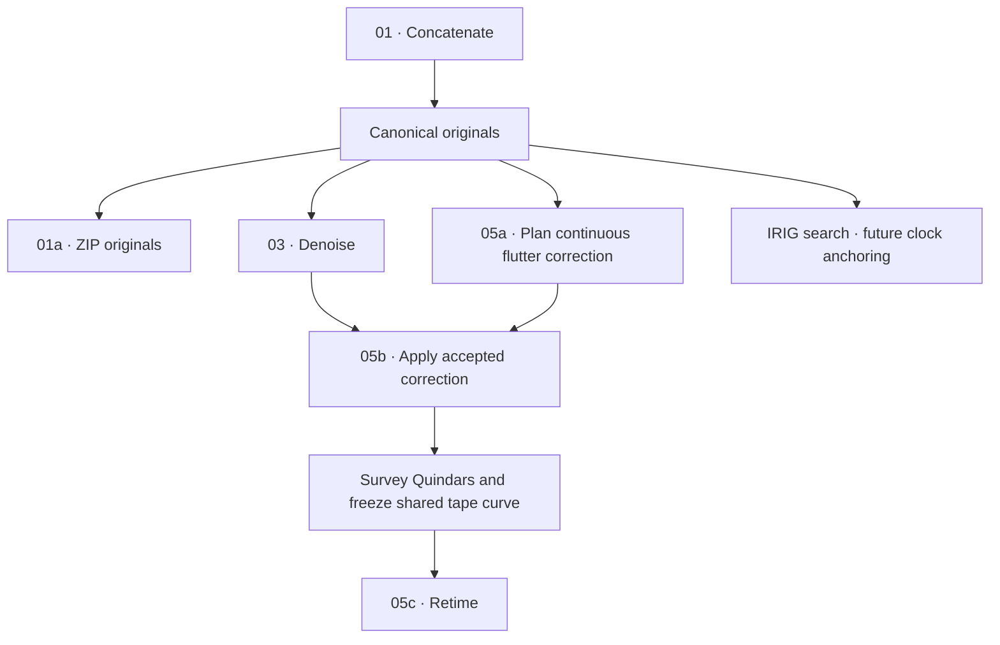

# Apollo 15 audio processing

Processing tools for the Apollo 15 30-track recordings. The current work is flutter correction and tape-speed retiming. Concatenation, original-file archiving, and denoising are complete pipeline stages.

| Stage | Entry point in `scripts/` | Purpose | Status |
| --- | --- | --- | --- |
| 01 | `01_concatenate.py` | Verify fragment order and assemble canonical channels | Done |
| 01a | `01a_zip_originals.py` | ZIP each canonical tape folder, skipping existing ZIPs | Done |
| 03 | `03_denoise.py` | Remove tones/hum and reduce broadband noise by at most 3 dB | Done |
| 05a | `05a_plan_deflutter.py` | Discover, validate, and continuously track timing references in originals | Active |
| 05b | `05b_deflutter.py` | Apply accepted saved maps to denoised channels and normalize | Active |
| 05c | `05c_retime.py` | Apply one shared Quindar speed curve per completed tape | Active |
| Future 06 or 05c integration | `irig_search.py` | Find provisional IRIG clock snapshots on original CH01–CH04 | Search utility available; integration undecided |



Reference analysis reads originals because denoising can remove useful tones. Flutter maps correct fast timing variation; Quindars measure slow tape-speed drift. IRIG clock discovery remains independent, preserving original sample coordinates for future anchoring.

## Setup and commands

Python 3.10+ and `uv` are required. Run from the repository root:

```powershell
uv sync --locked
uv run python scripts/pipeline.py --help
uv run python scripts/pipeline.py plan --stages 05a --all-tapes
uv run python scripts/pipeline.py run --stages 05a --all-tapes --plain
```

`plan` previews commands without writing outputs. Batch runs accept one stage per command. Use `--tape A15_T510083` for a single tape, and `--channel 20` for a specific audio channel. Stage 05a plans once per tape; stage 05b requires a complete plan, a prepared stage-03 intermediate, and matching production acceptance.

```powershell
uv run python scripts/pipeline.py run --stages 05b --all-tapes --plain
uv run python scripts/quindar_survey.py --tape A15_T510083 --workers 8
uv run python scripts/05c_retime.py --tape A15_T510083 --plan-only
uv run python scripts/pipeline.py run --stages 05c --tape A15_T510083 --all-channels --plain
```

Finish 05b for all expected audio channels before surveying Quindars. IRIG-only channels are excluded from rendering. The frozen curve is shared by every audio channel, including those without usable tones, while preserving historical head offsets.

The [operating and evidence guide](docs/continuous_reference_pipeline.md) covers checkpoint/resume, bounded listening reviews, qualification, and acceptance. Numeric planning success does not provide listening approval.

## IRIG search

Search the full originals on CH01–CH04 regardless of labels:

```powershell
uv run --extra irig python scripts/irig_search.py --input D:/Apollo_15_30-Track/orig_concatenated --all-tapes --legacy-repo F:/_repos/Apollo_Audio_Processing
```

The external checkout supplies the decoder. Use `--screen-only` without it for carrier screening; `--max-windows 30` bounds a trial. Resume by rerunning without the budget. Reports distinguish incomplete searches, carrier candidates, and qualifying sequential decodes. Clock basis remains provisional until authenticated. This search does not yet anchor the final audio to mission time.

## Data and source layout

Defaults are beneath `D:/Apollo_15_30-Track`; overrides are available in `--help`.

| Folder | Contents | Pipeline override |
| --- | --- | --- |
| `orig_delivery/` | Delivered fragments | `--delivery` |
| `orig_concatenated/` | Canonical originals | `--concatenated` |
| `denoised/` | Completed stage-03 channels | `--denoised-root` |
| `deflutter_planning_v4/` | Continuous reference plans, evidence, maps | `--flutter-planning-root` |
| `defluttered_v4/` | Stage-05b audio | `--defluttered-root` |
| `quindar_post_deflutter_analysis_v4/` | Surveys and frozen tape curves | `--quindar-analysis-root` |
| `defluttered_retimed_v4/` | Stage-05c audio | `--retimed-root` |
| `irig_search/` | Independent IRIG screening and clock evidence | Standalone search `--output` |

- `scripts/`: supported stage commands, shared processing, and listening-evidence utilities.
- `tests/`: processing, checkpoint integrity, acceptance, and pipeline integration checks. Synthetic demo generation lives here.
- `docs/`: the current operating guide and explanatory measurement images.
- Local `reports/`, `runs/`, and `archive/` are ignored artifacts. Recordings and processing outputs are not distributed with the source.

One-off experiments, old cleanup previews, the regional planner, and excerpt-manifest rendering have been retired. Historical saved-map reading remains for evidence compatibility. Source changes invalidate implementation-bound flutter plans and acceptance; use fresh destinations rather than changing old records. Completed stage-03 intermediates retain their existing cleanup fingerprint.

## Measurement examples


T510073 CH06, a 30-second review excerpt: grey is original, orange is after tone/hum cleanup, green adds the current 3 dB-capped broadband step. The lower plot isolates the broadband change. This illustrates cleanup, not proof of speech preservation.


Historical T510083 CH20 assessment: measured Quindars, a smoothed speed curve, and accumulated timing change. This single-channel example explains the method; production freezes a shared curve only after surveying the completed tape. Sparse coverage and unknown generator accuracy limit absolute calibration.

## Validation

```powershell
uv run python -m unittest discover -s tests -v
```
