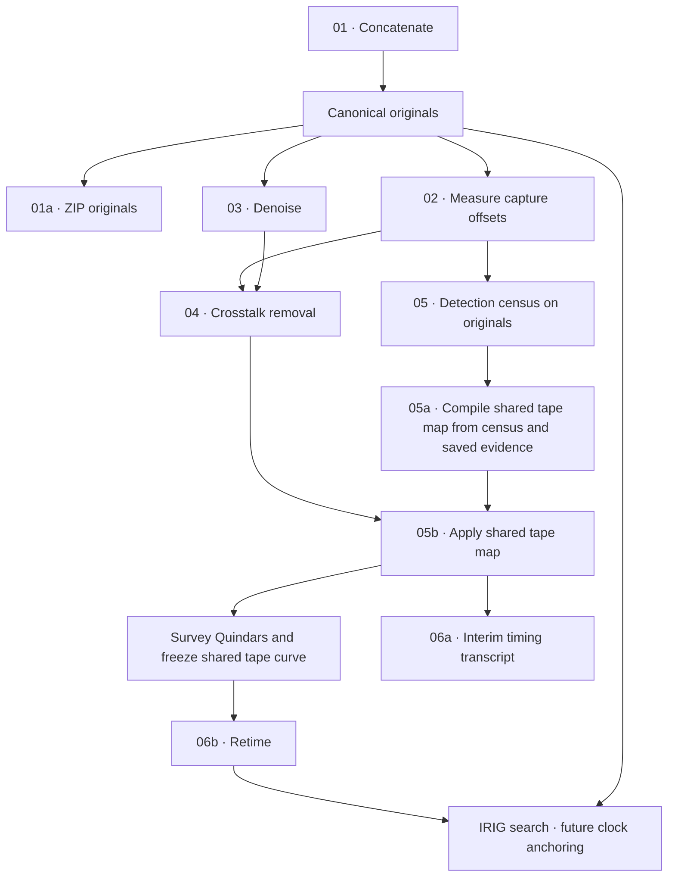
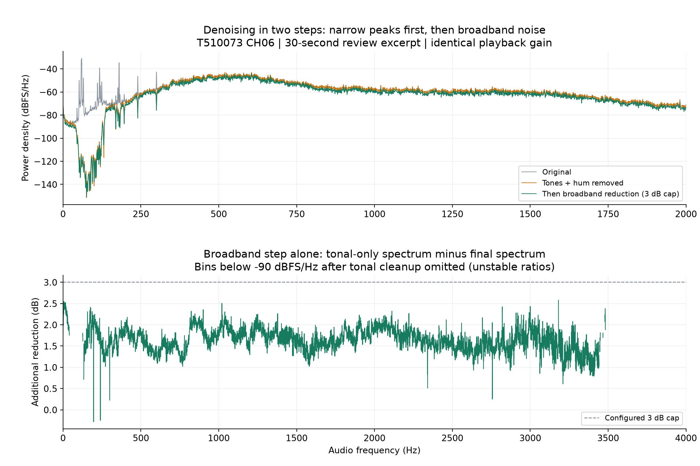
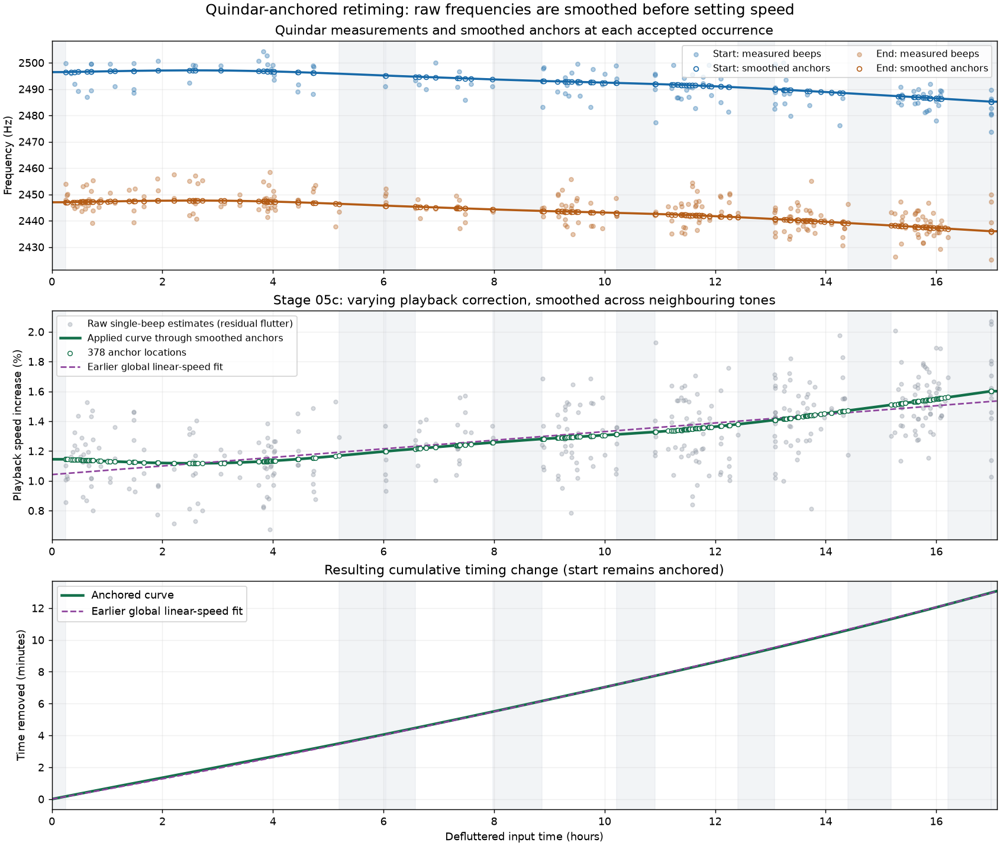

# Apollo 15 audio processing

Processing tools for the Apollo 15 30-track recordings. Current work includes the denoise v2 rollout, crosstalk removal, flutter correction, and tape-speed retiming. Concatenation, original-file archiving, and the earlier denoise v1 pass are complete.

**Flutter correction is tape-level:** use evidence from all simultaneous tracks
to select one shared timing map, applied across channels at the same tape time.
Missing check tones on an output channel do not independently disable correction.
See [the governing rule and shared-map workflow](docs/08_2026-11-15_shared_deflutter.md).
Stage 04 adds [evidence-bounded crosstalk removal](docs/06_2026-11-13_crosstalk_stage.md) after v2
denoising. Stage 05 compiles one shared tape map and applies it to stage-04 audio.
Stage 07 adds [speech-level normalization](docs/05_2026-11-13_speech_normalization.md) after
deflutter or retiming, with constant gain to a speech target and a bypass for uncertain channels.
New denoise runs write unity-gain float WAVs; stage 07 sets the final speech level.
Completed denoise outputs retain their existing gain.

On D:, open `Apollo_15_30-Track/crosstalk_removed/<tape>` for the latest
completed stage 04 channels, `deflutter_maps/<tape>` for the qualified
stage 05a map, and `defluttered_shared/<tape>` for published stage 05b audio.
Each tape folder exposes one edition. The project root's `STAGE_RESULTS.txt`
lists the other outputs, the measurements on F:, and the supporting evidence.

Start with [deflutter next steps](docs/12_2026-11-15_deflutter_next_steps.md),
the latest action plan for reviewing the implementation, resolving the
adverse window, benchmarking workers, and running the detection census.
Then read the [project status and local artifact guide](docs/11_2026-11-15_project_status.md)
for current context, earlier findings, and retained artifacts.

For the current denoise rollout, use the [Windows/Genus production console guide](docs/07_2026-11-15_denoise_cluster.md).
The [v2.16 rollout history](docs/02_2026-11-13_denoise_v2_all_tapes_runbook.md) and
[findings and local evidence index](docs/01_2026-11-11_denoise_v2_plan.md) retain review and migration context.

Stage 05 now starts with a [check-tone-free detection census](docs/10_2026-11-15_deflutter_detection.md):
blind cross-channel agreement of on-tape carriers, chiefly the 1971 mains hum
after the exact digitization lines are subtracted, joined into one stream per
tape on Proprius and Genus. The [shared tape workflow](docs/08_2026-11-15_shared_deflutter.md)
merges that stream with saved regional and v5 evidence, selects one curve per
tape-time interval and saves one integrated map. Stage 05b applies that
artifact to completed stage-04 channels derived from v2 denoising. Historical
evidence stays immutable. [Next steps](docs/12_2026-11-15_deflutter_next_steps.md) lists the
combined-host benchmark, archive run and listening trials that remain; the
[design guide](docs/09_2026-11-15_deflutter_detection_guide.md) keeps the research rationale.

| Stage | Entry point in `scripts/` | Purpose | Status |
| --- | --- | --- | --- |
| 01 | `01_ingest/01_concatenate.py` | Verify fragment order and assemble canonical channels | Done |
| 01a | `01_ingest/01a_zip_originals.py` | ZIP each canonical tape folder, skipping existing ZIPs | Done |
| 02 | `02_alignment/02_align_capture.py` | Measure channel start offsets on the originals for donor matching and flutter tracing | Source-bound alignment reports |
| 03 v1 | `03_denoise/03_denoise.py` | Remove tones/hum and reduce broadband noise by at most 3 dB | Existing archive |
| 03 v2 | `03_denoise/denoise_v2_console.py` | Qualified accelerated denoising on Windows and Genus | Active rollout; automatic Windows day/night limits |
| 04 | `04_crosstalk/04_crosstalk.py` | Remove evidenced weaker repeats; preserve timing and gain | Available; bounded evidence, bypass elsewhere |
| 05 | `05_deflutter/05_detect_flutter.py` | Blind cross-channel tape-motion census on originals (Proprius + Genus) | Resumable census on F with live worker monitoring |
| 05a | `05_deflutter/05a_plan_deflutter.py` | Compile one map from census and saved evidence across all channels | Shared tape maps |
| 05b | `05_deflutter/05b_deflutter.py` | Apply the tape map to stage-04 channels at their existing gain | Shared tape maps |
| 06a | `06_retime/06a_transcribe.py` | Interim timing transcript of 05b channels, used to place tapes on mission time. SG reels and DVD streams: `sg-audio/sg_transcribe.py`, `video/dvds/dvd_transcribe.py` ([runbook](docs/15_2026-11-22_transcription_runbook.md)) | New; final archive transcript follows retiming |
| 06b | `06_retime/06b_retime.py` | Apply one shared Quindar speed curve per completed tape (formerly stage 06) | Active |
| 07 | `07_normalize/07_normalize.py` | Constant gain to a speech target, noise-only bypass and transient peak limiting | New; listening calibration pending |
| 08 utility | `run.py irig_search.py` | Find provisional IRIG clock snapshots on original CH01-CH04 | Standalone utility in `08_irig/`; integration undecided |



The census measures motion on originals because cleanup can remove useful
tones. The exact 60 Hz harmonic comb is digitization contamination and is
subtracted; the 1971 hum recorded on the tape at 60·ρ·n Hz is the main witness.
Flutter maps apply after stage-04 crosstalk removal. Quindars measure slow
tape-speed drift. IRIG clock discovery remains independent, preserving original
sample coordinates for future anchoring.

## Setup and commands

Python 3.10+ and `uv` are required. Run from the repository root:

```powershell
uv sync --locked
uv run python scripts/pipeline.py plan --stages 05a --tape A15_T510076 --all-channels --plain
uv run python scripts/05_deflutter/05a_plan_deflutter.py --help
uv run python scripts/05_deflutter/inspect_tone.py --help
```

Stage 05 is the only stage that analyses audio for flutter; stage 05a compiles
completed evidence without running new discovery or fitting.
Use `--flutter-plan-workers 1` to limit simultaneous map builds while denoising
continues. `plan` previews commands without writes. Stage 05b requires a completed
shared map and completed stage-04 input derived from v2. A single tape/channel defaults to stage 05b.
Readiness to render does not imply listening acceptance.

See [the shared-map guide](docs/08_2026-11-15_shared_deflutter.md) for commands to compile,
render, export matched Audition WAVs, and trace visual tone sightings. Stage 05b
supports every numbered channel, including CH01; downstream Quindar analysis
retains its existing audio-channel scope. All outputs preserve source offsets.

## IRIG search

Search the full originals on CH01–CH04 regardless of labels:

```powershell
uv run --extra irig python scripts/run.py irig_search.py --input D:/Apollo_15_30-Track/orig_concatenated --all-tapes --legacy-repo F:/_repos/Apollo_Audio_Processing
```

The external checkout supplies the decoder. Use `--screen-only` without it for carrier screening; `--max-windows 30` bounds a trial. Resume by rerunning without the budget. Reports distinguish incomplete searches, carrier candidates, and qualifying sequential decodes. Clock basis remains provisional until authenticated. This search does not yet anchor the final audio to mission time.

## Data and source layout

Stage 05 flutter detection writes to `F:/Apollo_15_30-Track/deflutter_detection_census`.
The other stage defaults are beneath `D:/Apollo_15_30-Track`. See `--help` for overrides.

| Folder | Contents | Pipeline override |
| --- | --- | --- |
| `orig_delivery/` | Delivered fragments | `--delivery` |
| `orig_concatenated/` | Canonical originals | `--concatenated` |
| `denoised/` | Completed stage-03 channels | `--denoised-root` |
| `crosstalk_removed/` | Stage-04 audio, interval decisions and evidence bindings | `--crosstalk-root` |
| `deflutter_detection_census/<run-id>/` | Stage-05 census blocks, streams and cluster state | `--flutter-detection-root` |
| `deflutter_analysis/<run-id>/<analysis-id>/` | Qualified tape intervals, held-out validation and listening selections | `--flutter-qualification-root` (05a) |
| `stage_evidence/flutter/carrier_tones/` | Committed all-channel tone measurements used by the shared maps | `--flutter-evidence-root` |
| `deflutter_planning_shared/` | One map and selection provenance per tape | `--flutter-planning-root` |
| `defluttered_shared/` | Stage-05b audio after stage-04 crosstalk | `--defluttered-root` |
| `stage_evidence/retiming/` | Surveys and frozen tape curves | `--quindar-analysis-root` |
| `retimed/` | Stage-06b audio | `--retimed-root` |
| `speech_normalized/` | Stage-07 listening WAVs and measurement reports | `--normalized-root` |
| `irig_search/` | Independent IRIG screening and clock evidence | Standalone search `--output` |

- `scripts/`: the top-level `pipeline.py`, the `run.py` dispatcher, and numbered stage folders described in [the script layout guide](docs/04_2026-11-15_script_layout.md).
- `tests/`: processing, checkpoint integrity, acceptance, and pipeline integration checks. Synthetic demo generation lives here.
- `docs/`: Documents use `NN_YYYY-MM-DD_` prefixes and sort from historical research through current guides and status to the deflutter action plan (`12`) and [qualification and listening guide](docs/13_2026-11-17_deflutter_qualification.md). After completing the census, `05_analyze_flutter.py run` handles assessment through validation. Dates record the latest Git revision at this reorganization. Keep the order and referring links current as work progresses. Images live in `docs/images/`.
- Local `reports/`, `runs/`, and `archive/` are ignored artifacts. Recordings and processing outputs are not distributed with the source.

One-off experiments, old cleanup previews, the regional and v5 planners, the October 30 research campaign code, and excerpt-manifest rendering have been retired (recoverable from Git). Historical saved-map reading remains for evidence compatibility. Source changes invalidate implementation-bound flutter plans and acceptance; use fresh destinations rather than changing old records. Completed stage-03 intermediates retain their existing cleanup fingerprint.

## Measurement examples



T510073 CH06, a 30-second review excerpt: grey is original, orange is after tone/hum cleanup, green adds the current 3 dB-capped broadband step. The lower plot isolates the broadband change. This illustrates cleanup, not proof of speech preservation.



Historical T510083 CH20 assessment: measured Quindars, a smoothed speed curve, and accumulated timing change. This single-channel example explains the method; production freezes a shared curve only after surveying the completed tape. Sparse coverage and unknown generator accuracy limit absolute calibration.

## Validation

```powershell
uv run python -m unittest discover -s tests -v
uv run --with pytest python -m pytest tests -q
```
